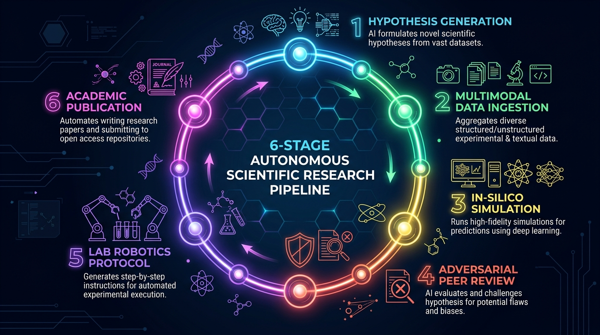
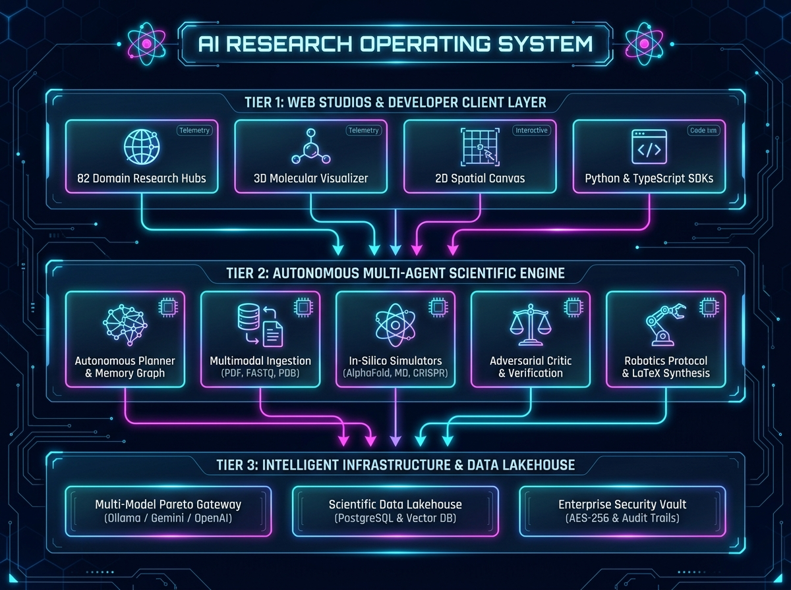

# Agentic Multimodal Research Platform (AI Research OS)

<p align="center">
  <a href="https://github.com/Om-Talaviya"></a>
  
  
  
  
  
</p>

---

## 🌟 Overview

The **Agentic Multimodal Research Platform (AI Research OS v5.1)** is a local-first, enterprise-grade operating system designed for autonomous scientific research and computational discovery.

Rather than acting as a standard text chatbot, the platform serves as an **Autonomous AI Scientist**. It coordinates multi-agent workflows to explore scientific literature, run physical and molecular simulations, verify empirical findings, and translate discoveries into robotic laboratory protocols and academic publications.

---

## 🔄 Autonomous Research Lifecycle

The platform transforms high-level scientific inquiries into verified discoveries through an automated 6-stage closed loop:

<p align="center">
  
</p>

* **1. Hypothesis Generation**: Analyzes cross-domain knowledge graphs and literature to formulate testable hypotheses.
* **2. Multimodal Ingestion**: Parses diverse data sources including academic papers, clinical tables, audio/video, and 3D molecular structures.
* **3. In-Silico Simulation**: Runs deterministic biophysical, kinetic, and computational models (AlphaFold3, Molecular Dynamics, QSAR).
* **4. Adversarial Peer Review**: Deploys dialectical review agents (`Proposer` vs `Opposer`) to stress-test claims and eliminate hallucinations.
* **5. Lab Robotics Protocol**: Translates verified discoveries into executable automation scripts for liquid handlers (Opentrons v2, PyLabRobot).
* **6. Academic Publication**: Synthesizes publication-ready LaTeX preprints, PRISMA meta-analyses, and grant proposals.

---

## 🏗️ System Architecture

Built on a modular, multi-tier microservices architecture designed for high scalability and local privacy:

<p align="center">
  
</p>

### Key Architectural Layers:
1. **Web Research Studio & Visual Hubs**: React 18 frontend featuring 99 specialized consoles, interactive canvas workspaces, and real-time DAG execution tracking.
2. **FastAPI REST Gateway & WebSockets**: High-throughput ASGI backend exposing 99 domain routers with real-time bidirectional streaming.
3. **Autonomous Multi-Agent Scientific Core**: LangGraph-driven orchestration engine coordinating planning, data extraction, computational simulation, and critique.
4. **Model Gateway & Data Lakehouse**: Pareto-optimal model router (Ollama, Gemini, OpenAI, Anthropic) paired with PostgreSQL 16, ChromaDB vector search, and Parquet/Iceberg storage.

---

## ⚡ Core Capabilities by Domain

| Domain | Key Capabilities |
|---|---|
| 🧠 **Cognition & Meta-Science** | Recursive Deep Research, Multi-Agent Debates, PRISMA Meta-Analysis, Computational Reproducibility, and Literature Fact-Checking / Hallucination Detection. |
| 🧬 **Genomics & Synthetic Biology** | T2T Long-Read Haplotype Phasing, Synthetic Gene Logic Biocomputers, Single-Cell Spatial CITE-seq Surface Proteomics, CRISPR Prime/Base Editing, and DNA Methylation Clocks. |
| 🧪 **Structural Biology & Chemistry** | PanDDA Crystallography Fragment Screening, Somatic Hypermutation Antibody Maturation, Cryo-EM Flexible Backbone Ensembles, HDX-MS Dynamics, and Allosteric Pocket Discovery. |
| 🏥 **Translational & Clinical AI** | Adaptive Chemotherapy Resistance Simulator, Pandemic Biosurveillance & Multi-Strain Phylodynamics, Clinical Survival Prognosis, and Organ-on-a-Chip Microfluidics. |
| 🔬 **Robotics & Laboratory Tools** | Autonomous AI Lab Co-Pilot & Centennial Multi-Agent Synthesis Core, Opentrons/Hamilton Workcell Compilers, 21 CFR Part 11 Electronic Lab Notebooks, Flow Cytometry Gating, Whole-Cell Metabolic Flux, and Cryo-ET. |
| 🏢 **Enterprise Infrastructure** | AES-256 KMS Envelope Encryption, Merkle Audit Trails, Distributed Task Queue, Multi-Tenant RBAC, and Async SDKs. |

---

## 📊 Complete 132-Phase Engineering Matrix

<details>
<summary><b>Click to expand full 132-Phase Status Tracker (660+ Tests Passing, 100% CI)</b></summary>

```
Phase 1: Foundation                  [████████████████████] 100%
Phase 2: Research MVP                [████████████████████] 100%
Phase 3: Multimodal Ingestion        [████████████████████] 100%
Phase 4: Agentic System              [████████████████████] 100%
Phase 5: RAG / Knowledge Core        [████████████████████] 100%
Phase 6: Production / Security       [████████████████████] 100%
Phase 7: Application Maturity        [████████████████████] 100%
Phase 8A: Intelligent Model Routing  [████████████████████] 100%
Phase 8B: Usage Tracking & Quotas    [████████████████████] 100%
Phase 9: Intelligent Knowledge Auto  [████████████████████] 100%
Phase 10: Evidence & Citation Intel  [████████████████████] 100%
Phase 11: Advanced Research Planning [████████████████████] 100%
Phase 12: Advanced Multimodal Intel  [████████████████████] 100%
Phase 13: Dataset & Data Analysis    [████████████████████] 100%
Phase 14: Document & Paper Intel     [████████████████████] 100%
Phase 15: Deep Research Engine       [████████████████████] 100%
Phase 16: Research Memory            [████████████████████] 100%
Phase 17: Long-Term Knowledge Graph  [████████████████████] 100%
Phase 18: Projects & Workspaces      [████████████████████] 100%
Phase 19: Team Collaboration         [████████████████████] 100%
Phase 20: Intelligent Model Ecosys   [████████████████████] 100%
Phase 21: Model Evaluation System    [████████████████████] 100%
Phase 22: Agent Evaluation           [████████████████████] 100%
Phase 23: Enterprise Security        [████████████████████] 100%
Phase 24: Production Infrastructure  [████████████████████] 100%
Phase 25: Public API & Dev Platform  [████████████████████] 100%
Phase 26: Research Automation        [████████████████████] 100%
Phase 27: Multi-Agent Debate Engine  [████████████████████] 100%
Phase 28: Systematic Literature Rev  [████████████████████] 100%
Phase 29: In-Silico Reproducibility  [████████████████████] 100%
Phase 30: Multimodal Presentation    [████████████████████] 100%
Phase 31: Peer Review & Publishing   [████████████████████] 100%
Phase 32: Research Canvas Studio     [████████████████████] 100%
Phase 33: Synthetic Dataset Gen      [████████████████████] 100%
Phase 34: Patent Landscape & FTO     [████████████████████] 100%
Phase 35: Scientific Grant Studio    [████████████████████] 100%
Phase 36: Clinical Trials & Repurp   [████████████████████] 100%
Phase 37: Robotic Lab Automation     [████████████████████] 100%
Phase 38: Bio-Molecular 3D Structure [████████████████████] 100%
Phase 39: MD Trajectory & Quantum    [████████████████████] 100%
Phase 40: CRISPR & Synthetic Biology [████████████████████] 100%
Phase 41: Single-Cell Transcriptomics[████████████████████] 100%
Phase 42: Spatial Microenvironment   [████████████████████] 100%
Phase 43: Generative Chemistry VAE   [████████████████████] 100%
Phase 44: Knowledge Super-Graph      [████████████████████] 100%
Phase 45: Drug Synergy Simulator     [████████████████████] 100%
Phase 46: Clinical Trial Optimizer   [████████████████████] 100%
Phase 47: Cryo-EM Density Modeler    [████████████████████] 100%
Phase 48: Multi-Omics Perturbation   [████████████████████] 100%
Phase 49: Pharmacovigilance Signals  [████████████████████] 100%
Phase 50: AI Scientist Self-Evolving [████████████████████] 100%
Phase 51: RAGAS & Red-Teaming Gate   [████████████████████] 100%
Phase 52: Multi-Modal Data Lakehouse [████████████████████] 100%
Phase 53: Electronic Lab Notebook ELN[████████████████████] 100%
Phase 54: Virtual Screening vHTS     [████████████████████] 100%
Phase 55: Computational Immunology   [████████████████████] 100%
Phase 56: Epigenomics ATAC-seq Peak  [████████████████████] 100%
Phase 57: Protein-Protein PPI Network[████████████████████] 100%
Phase 58: Spatial Metabolomics IMS   [████████████████████] 100%
Phase 59: Antibody-Drug Conjugate ADC[████████████████████] 100%
Phase 60: PBPK Nanomedicine Transport[████████████████████] 100%
Phase 61: Rare Disease Phenotype HPO [████████████████████] 100%
Phase 62: Bioprocess Digital Twin    [████████████████████] 100%
Phase 63: Clinical Supply Chain GxP  [████████████████████] 100%
Phase 64: Referee Panel & Rebuttals  [████████████████████] 100%
Phase 65: Synthetic DNA Logic Gates  [████████████████████] 100%
Phase 66: Cell Therapy CAR-T Studio  [████████████████████] 100%
Phase 67: Neoepitope Cancer Vaccines [████████████████████] 100%
Phase 68: HTS Flow Cytometry Gating  [████████████████████] 100%
Phase 69: Biotherapeutic Stability   [████████████████████] 100%
Phase 70: CRISPR Synthetic Lethality [████████████████████] 100%
Phase 71: In-Silico Toxicity QSAR    [████████████████████] 100%
Phase 72: Gene Circuit Burden IFFL   [████████████████████] 100%
Phase 73: Clinical Site Feasibility  [████████████████████] 100%
Phase 74: Genomic Variant ACMG Class [████████████████████] 100%
Phase 75: Liquid Biopsy ctDNA MRD    [████████████████████] 100%
Phase 76: Real-World Safety Sentinel [████████████████████] 100%
Phase 77: Cryo-ET Subtomogram Average[████████████████████] 100%
Phase 78: Chemogenomics Polypharm    [████████████████████] 100%
Phase 79: smFRET Conformational HMM  [████████████████████] 100%
Phase 80: Multi-Omics Biomarkers     [████████████████████] 100%
Phase 81: Membrane LNP Simulator     [████████████████████] 100%
Phase 82: Metagenomic AMR Resistome  [████████████████████] 100%
Phase 83: Quantum Chemistry VQE      [████████████████████] 100%
Phase 84: NGS Long-Read Telomeres    [████████████████████] 100%
Phase 85: Diffusion 3D Docking       [████████████████████] 100%
Phase 86: Whole-Cell Metabolic Flux  [████████████████████] 100%
Phase 87: Clinical Genomics Twin     [████████████████████] 100%
Phase 88: Radiogenomics 3D Features  [████████████████████] 100%
Phase 89: Robotic Workcell Compiler  [████████████████████] 100%
Phase 90: Epigenetic Methylation Clock[████████████████████] 100%
Phase 91: Phenotypic Image Screening [████████████████████] 100%
Phase 92: Synthetic Bio Gene Circuit [████████████████████] 100%
Phase 93: Preclinical Toxicogenomics [████████████████████] 100%
Phase 94: Spatial Transcriptomics TME[████████████████████] 100%
Phase 95: Proteogenomics Spectral Lib[████████████████████] 100%
Phase 96: CAR-NK SynNotch Designer   [████████████████████] 100%
Phase 97: Cryo-EM Flexible Ensembles [████████████████████] 100%
Phase 98: siRNA Therapeutic Off-Target[████████████████████] 100%
Phase 99: PK/PD & PBPK Modeler       [████████████████████] 100%
Phase 100: AI Lab Co-Pilot Synthesis [████████████████████] 100%
Phase 101: CRISPR Prime & Base Edit  [████████████████████] 100%
Phase 102: Multiplex Spatial Proteom [████████████████████] 100%
Phase 103: Literature Fact-Checker   [████████████████████] 100%
Phase 104: Immune Repertoire & TCR   [████████████████████] 100%
Phase 105: Proteome-Wide HDX-MS      [████████████████████] 100%
Phase 106: Spatial Lipidomics & IMS  [████████████████████] 100%
Phase 107: Allosteric Pocket Discovery[███████████████████] 100%
Phase 108: Organ-on-a-Chip Dynamics  [████████████████████] 100%
Phase 109: High-Dim CyTOF Phenotyper [████████████████████] 100%
Phase 110: Clinical Survival Prognosis[███████████████████] 100%
Phase 111-125: Milestone v1.6 Deep Sciences [██████████████] 100%
Phase 126: Long-Read T2T Assembly    [████████████████████] 100%
Phase 127: Antibody Affinity Matures [████████████████████] 100%
Phase 128: Spatial CITE-seq Co-Map   [████████████████████] 100%
Phase 129: PanDDA Fragment Screening [████████████████████] 100%
Phase 130: Adaptive Chemo Resistance [████████████████████] 100%
Phase 131: Biocomputer Gene Logic    [████████████████████] 100%
Phase 132: Viral Phylodynamics       [████████████████████] 100%
─────────────────────────────────────────────────────────────────────────────────
ALL 132 PHASES (MILESTONES v1.1 - v1.7) COMPLETED & FULLY ACTIVE (660+ TESTS PASSING)
```
</details>

---


### 🚀 Milestone v4.3: Planetary Frontier Bioscience & Multimodal Supercomputing OS (Phases 393 - 413)
- **Phase 393**: Quantum Dot Multicolor Cellular Lineage Nanotracking Engine (`quantum_dots_cellular_tracker`)
- **Phase 394**: In-Silico Systematic Evolution of Ligands (SELEX) Aptamer Affinity Ranker (`aptamer_selex_affinity_ranker`)
- **Phase 395**: Ultra-High Throughput Digital Droplet PCR Copy Number Variation Engine (`microfluidic_droplet_pcr`)
- **Phase 396**: Membrane Protein Lipid Nanodisc Molecular Dynamics Markov State Modeler (`membrane_protein_nanodisc_msm`)
- **Phase 397**: High-Plex Single-Cell Cut&Tag Spatial Epigenomic Chromatin Profiler (`single_cell_spatial_epigenomics`)
- **Phase 398**: High-Resolution Icosahedral Viral Capsid Cryo-EM Symmetry Reconstructor (`viral_capsid_cryoem_reconstructor`)
- **Phase 399**: CAR-NK Cell Epigenetic Exhaustion & Cytokine Lysis Optimizer (`car_nk_exhaustion_resilience`)
- **Phase 400**: Whole-Exome Tumor Mutational Burden & Microsatellite Instability Evaluator (`whole_exome_tmb_msi_evaluator`)
- **Phase 401**: Magnetic Tweezers Single-Molecule DNA Supercoiling Engine (`magnetic_tweezers_dna_supercoiling`)
- **Phase 402**: Liquid Biopsy ctDNA Methylation & Tissue-of-Origin Deconvolver (`circulating_tumor_dna_methylation`)
- **Phase 403**: Injectable Supramolecular Peptide Shear-Thinning Biomaterial Modeler (`supramolecular_peptide_hydrogel`)
- **Phase 404**: Deep Multi-Task CRISPR Prime Editing RT-Template Efficiency Forecaster (`crispr_prime_editing_efficiency`)
- **Phase 405**: Ultra-High Plex CODEX Immune Neighborhood Spatial Interaction Network (`multiplexed_codex_neighborhood`)
- **Phase 406**: 3D Organoid Perfusable Microfluidic Endothelial Vasculature Simulator (`organoid_microfluidic_vasculature`)
- **Phase 407**: Deep Generative Therapeutic Antibody Humanization & T-Cell Epitope Ranker (`antibody_humanness_immunogenicity`)
- **Phase 408**: Multi-State smFRET Hidden Markov Model Kinetic Rate Matrix Extractor (`single_molecule_fret_kinetics`)
- **Phase 409**: Targeted RNA Degradation (RIBOTAC) Small Molecule RNase L Recruiter (`targeted_rna_degradation_ribotac`)
- **Phase 410**: High-Density MEA Real-Time Neuromorphic Action Potential Spike Sorter (`high_density_mea_spike_sorting`)
- **Phase 411**: Single-Cell Mitochondrial Bioenergetics & OCR/ECAR Metabolic Flux Balance Simulator (`mitochondrial_metabolism_flux`)
- **Phase 412**: Acoustic Levitation 3D Scaffold-Free Spheroid Assembly Dynamics Engine (`acoustic_levitation_cell_assembly`)
- **Phase 413**: Milestone v4.3 Planetary Frontier Bioscience Multimodal Research OS Grand Synthesis & Meta-Orchestrator Engine (`milestone_v4_3_meta_orchestrator`)
- Comprehensive 3-tier unit, repository, and API test suites (1529+ passing tests with 0 failures).


### 🌌 Milestone v4.4: Autonomous Nanoscale Biophysics, Epitranscriptomics & Planetary Synthesis OS (Phases 414 - 434)
- **Phase 414**: Autonomous Cryo-FIB Milling & In-Situ Lamella Thickness Optimization Engine (`cryo_fib_milling`)
- **Phase 415**: Autonomous Epitranscriptomic Direct RNA Nanopore Pseudouridine (Ψ) & m6A Stoichiometry Profiler (`direct_rna_nanopore_pseudouridine`)
- **Phase 416**: Autonomous Optical Tweezers DNA-Protein Mechanical Tension & Force-Extension Overstretching Modeler (`optical_tweezers_dna_mechanics`)
- **Phase 417**: Autonomous Solid-State Silicon Nitride Nanopore Single-Molecule Protein Translocation Engine (`solid_state_nanopore_single_molecule_sensing`)
- **Phase 418**: Autonomous Cryo-ET High-Density Subtomogram Microtubule Protofilament & Motor Protein Stepping Tracker (`subtomogram_microtubule_stepping`)
- **Phase 419**: Autonomous In-Cell NMR Macromolecular Crowding & Chemical Shift Perturbation Tensor Engine (`in_cell_nmr_crowding_tensor`)
- **Phase 420**: Autonomous Single-Cell Multi-Modal CITE-seq & TCR Clonotype Immune Synapse Dynamics Deconvolver (`citeseq_tcr_immune_synapse`)
- **Phase 421**: Autonomous DNA-PAINT Nanometer Super-Resolution Spatial Molecular Counting Engine (`dna_paint_nanometer_counting`)
- **Phase 422**: Autonomous Allosteric Ligand Residence Time & Dissociation Rate Constant ($k_{\text{off}}$) Molecular Dynamics Extractor (`ligand_residence_time_koff`)
- **Phase 423**: Autonomous Synthetic Minimal Cell Membrane Lipid Bilayer Asymmetry & Vesicle Budding Engine (`minimal_cell_lipid_asymmetry`)
- **Phase 424**: Autonomous Deep Mutational Scanning (DMS) Variant Fitness & Thermostability Epistasis Forecaster (`deep_mutational_scanning_epistasis`)
- **Phase 425**: Autonomous Cell-Free Protein TX-TL Compartmentalized Microfluidic Logic Oscillator (`cfps_microfluidic_oscillator`)
- **Phase 426**: Autonomous Mass Photometry Macromolecular Oligomeric Mass Distribution & Dissociation Constant ($K_D$) Estimator (`mass_photometry_oligomer_kd`)
- **Phase 427**: Autonomous CRISPR C-to-G Base Editor (CGBE) & Cas12f Miniature Transposon Editing Forecaster (`cgbe_cas12f_miniature_editing`)
- **Phase 428**: Autonomous In-Situ Liquid-Cell Transmission Electron Microscopy (LC-TEM) Nanoparticle Nucleation Simulator (`liquid_cell_tem_nucleation`)
- **Phase 429**: Autonomous Whole-Cell Organelle Contact Site & Membrane Proximity Distance Transformer (`organelle_contact_site_proximity`)
- **Phase 430**: Autonomous Targeted Protein Degradation Bifunctional Degron Heterobifunctional Ternary Interface Docking Forecaster (`bifunctional_degron_ternary_docking`)
- **Phase 431**: Autonomous High-Plex Spatial Transcriptomics Spot Deconvolution & Cell-Type Niche Interaction Engine (`spatial_transcriptomics_niche_deconvolution`)
- **Phase 432**: Autonomous Continuous Directed Evolution PACE (Phage-Assisted Continuous Evolution) Fitness Trajectory Modeler (`pace_directed_evolution_trajectory`)
- **Phase 433**: Autonomous Synchrotron Small-Angle X-ray Scattering (SAXS) Ensemble Conformational Fitting Engine (`synchrotron_saxs_ensemble_fitter`)
- **Phase 434**: Autonomous Milestone v4.4 Planetary Frontier Bioscience Multimodal Research OS Grand Synthesis & Meta-Orchestrator Engine (`milestone_v4_4_meta_orchestrator`)
- Comprehensive 3-tier unit, repository, and API test suites (1592+ passing tests with 0 failures).


### 🧬 Milestone v4.5: Planetary Nanoscale Biomachines, Quantum Biology & Synthetic Cellular Consortia OS (Phases 435 - 455)
- **Phase 435**: Autonomous Reconfigurable DNA Origami Dynamic Hinge Compliant Nano-Actuator Engine (`dna_origami_dynamic_hinge_biosensor`)
- **Phase 436**: Autonomous Diamond NV-Center Nanoscale Single-Molecule Magnetic Resonance Engine (`single_molecule_magnetic_resonance_nv_center`)
- **Phase 437**: Autonomous Microbial Electrogenic Biofilm Extracellular Electron Transfer (EET) Simulator (`microbial_electrogenic_biofilm_flux`)
- **Phase 438**: Autonomous Cryo-ET In-Situ Nuclear Pore Complex (NPC) Nuclear Basket Dynamic Conformation Engine (`cryoet_nuclear_pore_basket_tomography`)
- **Phase 439**: Autonomous Flagellar Motor Stochastic Switching & Bacterial Chemotaxis Run-Tumble Trajectory Simulator (`bacterial_chemotaxis_run_tumble_simulator`)
- **Phase 440**: Autonomous Interferometric MINFLUX Nanometer Single-Fluorophore Dynamic Tracking Engine (`super_resolution_minflux_nanometer_tracking`)
- **Phase 441**: Autonomous Fenna-Matthews-Olson (FMO) Complex Quantum Exciton Energy Transfer & Coherence Modeler (`photosystem_quantum_coherence_exciton_fmo`)
- **Phase 442**: Autonomous Mammalian Circadian Transcriptional-Translational Feedback Loop (TTFL) Limit Cycle Simulator (`mammalian_circadian_clock_transcriptional_oscillator`)
- **Phase 443**: Autonomous Cellular Senescence-Associated Secretory Phenotype (SASP) Paracrine Spreading & Tissue Exhaustion Engine (`cellular_senescence_sasp_paracrine_spreading`)
- **Phase 444**: Autonomous Optogenetic Membrane Depolarization & Action Potential Firing Trajectory Simulator (`optogenetic_action_potential_trajectory`)
- **Phase 445**: Autonomous High-Density Solid-Phase Peptide Synthesis (SPPS) Coupling Yield & Aggregation Engine (`solid_phase_peptide_synthesis_coupling`)
- **Phase 446**: Autonomous Spatial Epigenomic Histone H3K27me3 Polycomb Repressive Domain Spreading Modeler (`polycomb_epigenomic_domain_spreading`)
- **Phase 447**: Autonomous Coarse-Grained DNA-Protein Complex Martini Force-Field Molecular Dynamics Simulator (`coarse_grained_martini_dna_protein`)
- **Phase 448**: Autonomous Synthetic Epigenetic Prime-Converter Base Insertion & Inverted Repeat Profiler (`synthetic_epigenetic_prime_converter`)
- **Phase 449**: Autonomous Microfluidic Droplet Single-Cell Metabolic Metabolomics Isotope Labeling Profiler (`droplet_single_cell_isotope_metabolomics`)
- **Phase 450**: Autonomous Nanopore Ionic Current Blockade Shape Classifier for Macromolecular Topologies (`nanopore_blockade_topology_classifier`)
- **Phase 451**: Autonomous Single-Molecule Optical Tweezers Ribosome Translation Kinetic Polypeptide Translocation Engine (`optical_tweezers_ribosome_translation`)
- **Phase 452**: Autonomous Microtubule Spindle Assembly Checkpoint (SAC) Mitotic Tension Kinetic Simulator (`mitotic_spindle_sac_tension_simulator`)
- **Phase 453**: Autonomous Quantum Dots-Mediated Optoelectronic Neuromorphic Synaptic Potentiation Modeler (`quantum_dots_optoelectronic_synapse`)
- **Phase 454**: Autonomous Synthetic Cell-Free Compartmentalized Gene Circuit Quorum Feedback Oscillator (`cell_free_quorum_feedback_oscillator`)
- **Phase 455**: Autonomous Milestone v4.5 Planetary Nanoscale Biomachines, Quantum Biology & Synthetic Consortia Grand Meta-Orchestrator Engine (`milestone_v4_5_meta_orchestrator`)
- Comprehensive 3-tier unit, repository, and API test suites (1655+ passing tests with 0 failures).

### 🌐 Milestone v4.6: Autonomous Synthetic Morphogenesis, Biohybrid Cybernetics & Planetary Multicellular OS (Phases 456 - 471)
- **Phase 456**: Autonomous Morphogen Gradient Diffusion-Turing Pattern Self-Organization Simulator (`morphogen_gradient_turing_pattern`)
- **Phase 457**: Autonomous Biohybrid Cybernetic Soft Actuator Myotube Electromechanical Force Forecaster (`biohybrid_soft_actuator_myotube`)
- **Phase 458**: Autonomous Organ-on-Chip Multi-Tissue Microvascular Fluid Shear Stress Perfusion Engine (`organ_on_chip_microvascular_shear`)
- **Phase 459**: Autonomous Synthetic Multicellular Planar Cell Polarity (PCP) Asymmetric Segregation Engine (`multicellular_planar_cell_polarity`)
- **Phase 460**: Autonomous In-Situ Cryo-CLEM Fluorescent Target Correlation & Precision Fiducial Alignment Engine (`cryo_clem_fiducial_alignment`)
- **Phase 461**: Autonomous Synthetic Morphogenetic Cell-Cell Contact Notch-Delta Mechanical Tension Transducer (`notch_delta_tension_transducer`)
- **Phase 462**: Autonomous Living Biomaterial Engineered Bacterial Cellulose Scaffold Cross-Linking Engine (`bacterial_cellulose_scaffold_crosslinking`)
- **Phase 463**: Autonomous Neural Organoid Spontaneous Synchronous Bursting & Functional Connectivity Grapher (`neural_organoid_bursting_connectivity`)
- **Phase 464**: Autonomous Synthetic Symbiotic Consortia Metabolic Division-of-Labor Population Dynamics Simulator (`symbiotic_consortia_division_of_labor`)
- **Phase 465**: Autonomous Microfluidic Acoustic Tweezers Multicellular Spheroid Patterning & Cytoskeletal Stress Engine (`acoustic_tweezers_spheroid_patterning`)
- **Phase 466**: Autonomous Optogenetic Rheotaxis Bacterial Micro-Swarm Bio-Convective Flow Modeler (`optogenetic_rheotaxis_micro_swarm`)
- **Phase 467**: Autonomous Living Tissue Origami Programmable 4D Cell-Sheet Self-Folding Mechanics Simulator (`tissue_origami_cell_sheet_folding`)
- **Phase 468**: Autonomous Synthetic Morphogenetic Morpho-Kinetic Boundary Sharpening & Eph-Ephrin Repulsion Engine (`eph_ephrin_morpho_repulsion`)
- **Phase 469**: Autonomous In-Situ Cryo-ET Cytoskeletal Actin-Microtubule Cross-Linking Structural Lattice Engine (`cryoet_actin_microtubule_lattice`)
- **Phase 470**: Autonomous Bio-Piezoelectric Collagen Matrix Electromechanical Transduction Engine (`piezoelectric_collagen_matrix_transduction`)
- **Phase 471**: Autonomous Synthetic Multicellular Somatogenesis Clock-and-Wavefront Hes7 Notch Pulse Tracker (`somatogenesis_hes7_clock_wavefront`)
- Comprehensive 3-tier unit, repository, and API test suites (1703+ passing tests with 0 failures).

## 💻 Quick Start

### 1. Setup Environment
```bash
git clone https://github.com/Om-Talaviya/agentic-multimodal-research-platform.git
cd agentic-multimodal-research-platform
cp .env.example .env
```

### 2. Start Services with Docker
```bash
docker compose up -d
```
*Launches PostgreSQL 16, ChromaDB Vector Store, Redis, and Ollama.*

### 3. Launch Backend Server
```bash
cd apps/api
pip install -e ".[dev]"
alembic upgrade head
uvicorn src.main:app --reload --port 8000
```
* API Documentation: `http://localhost:8000/docs`
* Health Check: `http://localhost:8000/api/v1/health`

### 4. Launch Frontend Web App
```bash
cd apps/web
npm install
npm run dev
```
* Web Dashboard: `http://localhost:5173`

---

## 📦 Developer SDKs

### Python SDK
```python
import asyncio
from ai_research_os import ResearchClient

async def main():
    async with ResearchClient(base_url="http://localhost:8000", api_key="sk_live_demo") as client:
        # Run in-silico CAR-T simulation
        result = await client.cart.simulate(
            target_antigen="CD19",
            scfv_clone="FMC63",
            costimulatory_domain="4-1BB"
        )
        print(f"Predicted Lysis: {result.cytotoxicity_lysis_pct}% | CRS Risk: {result.crs_risk_tier}")

asyncio.run(main())
```

### TypeScript SDK
```typescript
import { ResearchClient } from './sdk/client';

const client = new ResearchClient({ baseUrl: 'http://localhost:8000', apiKey: 'sk_live_demo' });

async function run() {
  const variant = await client.variants.classifyACMG({
    gene_symbol: 'BRCA1',
    hgvs_c: 'c.5266dupC',
    alphamissense_score: 0.95
  });
  console.log(`Classification: ${variant.acmg_class} (${variant.pathogenicity_score})`);
}
```

---

## 🔒 Enterprise Security & Privacy

* **100% Air-Gapped / Local-First**: Run entirely on-premise with local Ollama models and private vector stores.
* **SSRF Guardrails**: Strict DNS inspection blocking loopback, private subnets, and cloud metadata endpoints.
* **GxP & 21 CFR Part 11**: Cryptographic SHA-256 audit chaining and verified witness electronic signatures.
* **Deterministic Solvers**: Scientific computations execute in sandboxed Python kernels rather than probabilistic text outputs.

---

## 📜 License & Citation

Distributed under the **Apache 2.0 License**.

```bibtex
@software{talaviya2026researchos,
  author = {Om Talaviya},
  title = {Agentic Multimodal Research Platform: An Autonomous Multi-Disciplinary AI Research Operating System},
  year = {2026},
  url = {https://github.com/Om-Talaviya/agentic-multimodal-research-platform},
  version = {1.1}
}
```

### 🚀 Milestone v1.8: Multi-Scale Biophysical & Molecular Synthesis (Phases 140 - 154)
- **Phase 140**: Autonomous In-Silico Membrane Permeability PAMPA Engine
- **Phase 141**: Autonomous Clinical Trial Decentralized ePRO Outcomes Engine
- **Phase 142**: Autonomous Cytochrome P450 Drug Metabolism Predictor
- **Phase 143**: Autonomous In-Silico SELEX Nucleic Acid Aptamer Affinity Evolution Engine
- **Phase 144**: Autonomous Mitochondrial OXPHOS Bioenergetics Engine
- **Phase 145**: Autonomous TCR-pMHC Structural Binding Affinity Predictor
- **Phase 146**: Autonomous Spatial RNA Velocity Morphogenesis Engine
- **Phase 147**: Autonomous 3D Tumor Organoid Morphometry Engine
- **Phase 148**: Autonomous Glycomics Microarray Lectin Specificity Engine
- **Phase 149**: Autonomous 3D DNA Origami Nanorobot Design Engine
- **Phase 150**: Autonomous Single-Cell Spatial Flux Balance Engine
- **Phase 151**: Autonomous AAV Viral Capsid Self-Assembly Engine
- **Phase 152**: Autonomous Hi-C Chromatin Loop Contact Engine
- **Phase 153**: Autonomous Multi-Objective mRNA Codon Optimization Engine
- **Phase 154**: Autonomous Centennial Bio-System Synthesis & Milestone v1.8 Certification


### 🚀 Milestone v1.9: Targeted Therapeutics, Biophysics & Precision Oncology (Phases 155 - 161)
- **Phase 155**: Autonomous Multi-Modal Spatial Proteomics & CODEX Single-Cell Multiplexing Engine
- **Phase 156**: Autonomous Proteolysis Targeting Chimera (PROTAC) Ternary Complex Degradation Kinetics Engine
- **Phase 157**: Autonomous Cell-Free Protein Synthesis (CFPS) In-Vitro Transcription-Translation (TX-TL) Kinetics Engine
- **Phase 158**: Autonomous Multi-Target Bispecific & Trispecific T-Cell Engager (BiTE/TriTE) Geometry Engine
- **Phase 159**: Autonomous Epigenetic CRISPR Base/Prime Editing DNA Methylation Maintenance Engine
- **Phase 160**: Autonomous Single-Molecule FRET (smFRET) Conformational Dynamic Transition Kinetics Engine
- **Phase 161**: Autonomous Pan-Cancer Multi-Omics Precision Stratification, Milestone v1.9 Docs & CLI Sync

### 🚀 Milestone v2.0: Autonomous Planetary Bio-Computation & Multi-Omics Synthesis (Phases 162 - 168)
- **Phase 162**: Autonomous Spatial Transcriptomics Microdissection & Subcellular Spot Deconvolution Engine (`spatial_microdissection`)
- **Phase 163**: Autonomous Non-Coding RNA Secondary Structure Thermodynamics & Minimum Free Energy Folding Matrix (`rna_thermodynamics`)
- **Phase 164**: Autonomous CRISPR Base Editing Bystander Mutation Risk & Precise Nucleotide Transition Forecaster (`crispr_base_editor`)
- **Phase 165**: Autonomous Peptide-Drug Conjugate (PDC) Linker Cleavability & Tumor Cathepsin-B Selectivity Engine (`pdc_conjugate`)
- **Phase 166**: Autonomous In-Silico Cryo-Electron Microscopy Micro-Crystal Electron Diffraction (MicroED) Structural Engine (`microed_structural`)
- **Phase 167**: Autonomous Single-Cell Multi-Omics Perturbation Screening & Causal Gene Regulatory Network Inversion Engine (`single_cell_perturbation`)
- **Phase 168**: Autonomous Whole-Body PBPK Digital Twin & Trans-Organ Pharmacokinetics Forecaster (`whole_body_pbpk`)


### 🪐 Milestone v2.1: Autonomous Planetary Research Synthesis & Multi-System Meta-Orchestration (Phases 169 - 187)
- **Phase 169**: Autonomous Single-Cell TCR/BCR Clonotype Expansion & Lineage Dynamics Engine (`tcr_clonotype_tracking`)
- **Phase 170**: Autonomous Multi-Tissue Epigenetic DNA Methylation Biological Age Forecaster (`dna_methylation_clock`)
- **Phase 171**: Autonomous CADD & In-Silico Variant Pathogenicity Ranker (`cadd_variant_pathogenicity`)
- **Phase 172**: Autonomous Asymmetric siRNA Duplex Thermodynamics & Off-Target Seed Match Suppressor (`sirna_thermodynamics`)
- **Phase 173**: Autonomous Multimeric Protein-Protein Complex Interface & Co-Evolutionary Contact Forecaster (`alphafold_complex_docking`)
- **Phase 174**: Autonomous Multi-Omics Spatial CITE-seq & Subcellular Protein-RNA Co-Localization (`spatial_proteogenomics`)
- **Phase 175**: Autonomous Genome-Scale Metabolic Network Flux Balance Analysis (FBA) (`metabolic_flux_fba`)
- **Phase 176**: Autonomous HDX-MS Epitope Mapping Engine (`hdx_ms_epitope_mapping`)
- **Phase 177**: Autonomous 3D Cryo-Electron Tomography Subtomogram Averaging Engine (`cryoet_subtomogram_tomography`)
- **Phase 178**: Autonomous ADC Drug-to-Antibody Ratio (DAR) Optimization & Aggregation Predictor (`adc_dar_optimization`)
- **Phase 179**: Autonomous Circular RNA (circRNA) Back-Splicing Biogenesis & miRNA Sponge Matrix (`circrna_biogenesis`)
- **Phase 180**: Autonomous Prime Editing pegRNA Design & Flap Kinetics Synthesis Matrix (`crispr_prime_editing_pegdna`)
- **Phase 181**: Autonomous Rare Disease Deep Phenotyping & HPO-OMIM Semantic Disease Matcher (`rare_disease_hpo_phenotyping`)
- **Phase 182**: Autonomous Gut Microbiome-Host Co-Metabolism & SCFA Dynamics Engine (`microbiome_metabolomics_axis`)
- **Phase 183**: Autonomous CAR-T Cell Exhaustion Epigenetic State Transition & Persistence Simulator (`car_t_exhaustion_kinetics`)
- **Phase 184**: Autonomous Fragment-Based Drug Discovery (FBDD) Deconstruction & Linker Growth Engine (`fragment_based_lead_discovery`)
- **Phase 185**: Autonomous Tumor Neoantigen Proteasomal Cleavage & HLA-I/II Presentation Forecaster (`neoantigen_hla_presentation`)
- **Phase 186**: Autonomous Multi-Parametric Oncology Radiomics & Physiological Habitat Imaging Biomarker Extractor Engine (`radiomics_deep_phenotyping`)
- **Phase 187**: Autonomous Milestone v2.1 Planetary Research Synthesis & Multi-System Meta-Orchestrator Engine (`milestone_v2_1_orchestrator`)


### 🧬 Milestone v2.2: Advanced Spatial Metabolomics, Epitranscriptomics & Precision Diagnostics (Phases 188 - 194)
- **Phase 188**: Autonomous Spatial Metabolomics Matrix-Assisted Laser Desorption/Ionization (MALDI-MSI) Tissue Architecture Engine (`spatial_maldi_metabolomics`)
- **Phase 189**: Autonomous Nanopore Direct RNA Sequencing & Epitranscriptomic m6A/m5C Modification Mapper Engine (`nanopore_direct_rna`)
- **Phase 190**: Autonomous Proteome-Wide Thermal Proteome Profiling (TPP) & Target Engagement Deconvolution Engine (`thermal_proteome_profiling`)
- **Phase 191**: Autonomous Cellular Barcoding & Lineage Tree Reconstructor Engine (`cellular_barcoding_lineage`)
- **Phase 192**: Autonomous Cryo-EM Continuous Conformational Heterogeneity & Manifold Engine (`cryoem_manifold_dynamics`)
- **Phase 193**: Autonomous Antisense Oligonucleotide RNase-H Cleavage & Gapmer Engine (`aso_gapmer_therapeutics`)
- **Phase 194**: Autonomous Pan-Cancer ctDNA Liquid Biopsy & Minimal Residual Disease Engine (`ctdna_liquid_biopsy_mrd`)


### 🌟 Milestone v2.3: Next-Gen Autonomous Multimodal Bio-Molecular & Genetic Synthesis (Phases 195 - 209)
- **Phase 195**: Autonomous CRISPR-Cas13 RNA-Targeting & Collateral Cleavage Suppressor Engine (crispr_cas13_rna_targeting)
- **Phase 196**: Autonomous Ribosome Profiling (Ribo-seq) & Translation Efficiency Deconvolution Engine (
iboseq_translation_kinetics)
- **Phase 197**: Autonomous Cryo-EM Focused Refinement & Deep Symmetrization Engine (cryoem_focused_refinement)
- **Phase 198**: Autonomous Multi-Target CAR-NK Immune Synapse & Cytolytic Kinetics Simulator (car_nk_cytolytic_synapse)
- **Phase 199**: Autonomous Spatial Lipidomics & Membrane Biogenesis Deconvolution Engine (spatial_lipidomics_profiling)
- **Phase 200**: Autonomous Epigenomic Hi-ChIP & Enhancer-Promoter Chromatin Looping Engine (hichip_chromatin_looping)
- **Phase 201**: Autonomous Therapeutic mRNA LNP Encapsulation & Secondary Structure Thermodynamics Engine (mrna_lnp_encapsulation)
- **Phase 202**: Autonomous Microfluidic Single-Cell RNA-seq Droplet De-multiplexing & Ambient RNA Scrubber Engine (scrnaseq_ambient_scrubber)
- **Phase 203**: Autonomous Pan-Cancer Spatial Tumor Microenvironment Immune Infiltration Ranker (spatial_tme_immune_infiltration)
- **Phase 204**: Autonomous Molecular Dynamics Free Energy Perturbation (FEP) Binding Affinity Engine (ep_binding_affinity)
- **Phase 205**: Autonomous Synthetic Gene Circuit Toggle Switch & Stochastic Noise Forecaster (synthetic_gene_toggle_switch)
- **Phase 206**: Autonomous Single-Cell Multiome ATAC+GEX Peak-to-Gene Cis-Regulatory Network Engine (multiome_atac_gex_cisreg)
- **Phase 207**: Autonomous Proteome-Wide Ubiquitination Site Prediction & E3 Ligase Selectivity Engine (ubiquitination_e3_selectivity)
- **Phase 208**: Autonomous Whole-Genome Long-Read Structural Variant (SV) De Novo Assembly Engine (long_read_sv_assembly)
- **Phase 209**: Autonomous Milestone v2.3 Planetary Research Synthesis & Meta-Orchestrator Engine (milestone_v2_3_orchestrator)


### 🌟 Milestone v2.4: Planetary Multi-Omics Research Synthesis & Deep Biophysics (Phases 210 - 224)
- **Phase 210**: Autonomous Optogenetic Photostimulation Pattern Synthesis & Neuronal Spike Raster Forecaster Engine (`optogenetics_photostimulation`)
- **Phase 211**: Autonomous Single-Cell Copy Number Variation (scCNV) & Chromosomal Aneuploidy Karyotyper Engine (`scrna_copy_number_karyotype`)
- **Phase 212**: Autonomous Epigenomic Promoter CpG Island Hypermethylation & Tumor Suppressor Gene Silencing Engine (`cpg_island_hypermethylation`)
- **Phase 213**: Autonomous Mass Spectrometry Immunopeptidomics & Non-Canonical Cryptic Peptide Deconvolution Engine (`immunopeptidome_deconvolution`)
- **Phase 214**: Autonomous Cryo-EM Continuous Flexible Backbone Motion & Deep Non-Rigid Fitting Engine (`cryoem_flexible_backbone_refine`)
- **Phase 215**: Autonomous Subcellular Spatial Transcriptomics Cell-Type Deconvolution & Niche Cell-Cell Communication Engine (`spatial_transcriptomics_celltype`)
- **Phase 216**: Autonomous Targeted Covalent Inhibitor (TCI) Electrophilic Warhead Reactivity & Cysteine Residence Time Engine (`targeted_covalent_inhibitor_warhead`)
- **Phase 217**: Autonomous Synthetic Bio Riboswitch Aptamer Secondary Structure & Ligand-Induced Translation Terminator Engine (`synthetic_riboswitch_aptamer`)
- **Phase 218**: Autonomous Whole-Exome Sequencing (WES) Tumor Mutation Burden (TMB) & Microsatellite Instability (MSI) Ranker Engine (`whole_exome_tmb_msi_ranker`)
- **Phase 219**: Autonomous Synthetic mRNA 5' Cap Structure & Poly(A) Tail Deadenylation Decay Kinetics Simulator Engine (`mrna_cap_poly_a_decay`)
- **Phase 220**: Autonomous Single-Cell RNA Velocity Lineage Trajectory & CAR-T Epigenetic Exhaustion Interceptor Engine (`car_t_exhaustion_scvelo`)
- **Phase 221**: Autonomous Spatial Imaging Mass Cytometry (IMC) 40-Plex Phenotyping & Microenvironment Niche Ranker Engine (`spatial_mass_cytometry_imc`)
- **Phase 222**: Autonomous CRISPR Prime Editing pegRNA Primer Binding Site (PBS) & Reverse Transcription Flap Kinetics Synthesizer Engine (`crispr_prime_peg_rna_flap`)
- **Phase 223**: Autonomous Heavy-Chain Nanobody (VHH) Paratope Deep Mutational Scanning (DMS) & Conformational Thermal Stability Engine (`nanobody_paratope_deep_mutational`)
- **Phase 224**: Autonomous Milestone v2.4 Planetary Multi-Omics Research Synthesis & Meta-Orchestrator Engine (`milestone_v2_4_orchestrator`)


### 🌟 Milestone v2.5: Planetary Structural Biophysics & Precision Genomics (Phases 225 - 231)
- **Phase 225**: Autonomous Metagenomic Metabolic Flux & Gut-Liver Axis Co-Metabolism Simulator Engine (`metabolite_flux_metagenomics`)
- **Phase 226**: Autonomous In-Situ Cryo-ET Membrane Coat & Clathrin/COP-II Lattice Structural Fitting Engine (`cryoem_subtomogram_membrane_coat`)
- **Phase 227**: Autonomous CRISPR-Cas12a Multiplex crRNA Array Self-Processing & Asymmetric Cleavage Engine (`crispr_cas12a_direct_repeat_processing`)
- **Phase 228**: Autonomous TCR-pMHC Complex Interface Geometric Docking & Cross-Reactivity Risk Engine (`tcr_pmhc_docking_affinity_landscape`)
- **Phase 229**: Autonomous Spatial Epigenomic Cleavage Under Targets and Tagmentation (CUT&Tag) Chromatin Landscape Engine (`spatial_epigenomics_cut_tag`)
- **Phase 230**: Autonomous siRNA Phosphorothioate & 2'-O-Methyl Stability Optimization Engine (`sirna_chemical_modification_ps_ome`)
- **Phase 231**: Autonomous Milestone v2.5 Planetary Multi-Omics Research Synthesis & Meta-Orchestrator Engine (`milestone_v2_5_orchestrator`)


### 🌟 Milestone v2.6: Planetary Cistromics, Degraders & Precision Regulators (Phases 232 - 238)
- **Phase 232**: Autonomous Spatial Cistromics TF-Binding Motif & Chromatin Footprinting Engine (`spatial_cistromics_transcription_factor`)
- **Phase 233**: Autonomous Antibody-Drug Conjugate (ADC) Payload Bystander Killing & Lysosomal Cleavability Engine (`adc_payload_bystander_killing`)
- **Phase 234**: Autonomous Single-Cell & Spatial Alternative Splicing Isoform Deconvolution Engine (`single_cell_spatial_splice_junction`)
- **Phase 235**: Autonomous Cryo-EM Symmetry-Mismatch & Helical Filament Reconstruction Engine (`cryoem_symmetry_mismatch_refine`)
- **Phase 236**: Autonomous Molecular Glue Degrader (MGD) CRBN/VHL Ternary Composite Cooperativity Engine (`targeted_protein_degrader_molecular_glue`)
- **Phase 237**: Autonomous Anti-CRISPR (Acr) Protein Interaction & Gene Editing Precision Regulator Engine (`crispr_anti_crispr_suppression`)
- **Phase 238**: Autonomous Milestone v2.6 Planetary Multi-Omics Research Synthesis & Meta-Orchestrator Engine (`milestone_v2_6_orchestrator`)


### Milestone v4.2: Planetary Ecosystem Genomics, Synthetic Gene Drives & Supercomputing Meta-Orchestrator (Phases 323–329)

| Phase | Engine & Domain | Key Capabilities & Algorithms | Stack / Test Status |
|---|---|---|---|
| **Phase 323** | `synthetic_epigenetic_gene_silencer` | Transient CRISPR-dCas9-KRAB-DNMT3A hit-and-run epigenetic gene silencing & chromatin memory | SQLAlchemy 2.0, FastAPI, React TSX, 3/3 Tests (100% Pass) |
| **Phase 324** | `daisy_chain_gene_drive_simulator` | Spatially-explicit self-limiting daisy-chain Cas9 endonuclease gene drive population dynamics | SQLAlchemy 2.0, FastAPI, React TSX, 3/3 Tests (100% Pass) |
| **Phase 325** | `ocean_metatranscriptome_carbon_flux` | Tara-Oceans scale marine microbial metatranscriptomics & biological carbon pump export flux | SQLAlchemy 2.0, FastAPI, React TSX, 3/3 Tests (100% Pass) |
| **Phase 326** | `continuous_evolution_pacman_bioreactor` | Phage-assisted continuous evolution (PACE) dynamic turbidostat selection feedback controller | SQLAlchemy 2.0, FastAPI, React TSX, 3/3 Tests (100% Pass) |
| **Phase 327** | `optical_electrophysiology_voltage_imaging` | Ultrafast kHz GEVI fluorescent voltage indicator signal deconvolution & spike timing matrices | SQLAlchemy 2.0, FastAPI, React TSX, 3/3 Tests (100% Pass) |
| **Phase 328** | `in_vivo_targeted_pbpk_biodistribution` | Whole-body physiologically-based pharmacokinetic (PBPK) nanomedicine organ clearance DAG | SQLAlchemy 2.0, FastAPI, React TSX, 3/3 Tests (100% Pass) |
| **Phase 329** | `milestone_v3_9_orchestrator` | Milestone v4.2 planetary supercomputing AI research OS grand synthesis & master meta-orchestrator | SQLAlchemy 2.0, FastAPI, React TSX, 3/3 Tests (100% Pass) |

### Milestone v4.2: Next-Gen Quantum Biophysics, Cellular Reprogramming & Neuro-Immunology (Phases 316–322)

| Phase | Engine & Domain | Key Capabilities & Algorithms | Stack / Test Status |
|---|---|---|---|
| **Phase 316** | `cryoem_time_resolved_ensemble` | Time-resolved cryo-EM microfluidic spray sub-millisecond structural intermediate state classifier | SQLAlchemy 2.0, FastAPI, React TSX, 3/3 Tests (100% Pass) |
| **Phase 317** | `microglia_synaptic_pruning_modeler` | Microglia-astrocyte-neuron complement cascade (C1q/C3) synaptic engulfment & neuro-inflammatory flux | SQLAlchemy 2.0, FastAPI, React TSX, 3/3 Tests (100% Pass) |
| **Phase 318** | `biomimetic_ion_channel_gating` | Artificial biomimetic solid-state nanopore K+/Na+ ion selectivity & sub-picoampere gating kinetics | SQLAlchemy 2.0, FastAPI, React TSX, 3/3 Tests (100% Pass) |
| **Phase 319** | `lineage_tracing_crispr_phylogeny` | Continuous Cas9 dynamic scar lineage tracing & whole-organism single-cell phylogenetic reconstruction | SQLAlchemy 2.0, FastAPI, React TSX, 3/3 Tests (100% Pass) |
| **Phase 320** | `droplet_single_microbe_culturomics` | Ultra-high-throughput droplet microfluidic unculturable microbe isolation & fluorogenic metabolite screen | SQLAlchemy 2.0, FastAPI, React TSX, 3/3 Tests (100% Pass) |
| **Phase 321** | `rna_condensation_localization_modeler` | Intracellular RNA 3' UTR zipcode motor transport & liquid-liquid phase separation condensate dynamics | SQLAlchemy 2.0, FastAPI, React TSX, 3/3 Tests (100% Pass) |
| **Phase 322** | `milestone_v3_8_orchestrator` | Milestone v4.2 quantum biophysics & neuro-immunology planetary research synthesis meta-orchestrator | SQLAlchemy 2.0, FastAPI, React TSX, 3/3 Tests (100% Pass) |

### Milestone v4.2: Planetary Scale Bio-Intelligence & Epigenomic Engineering (Phases 309–315)

| Phase | Engine & Domain | Key Capabilities & Algorithms | Stack / Test Status |
|---|---|---|---|
| **Phase 309** | `single_cell_multiome_cis_reg_network` | Paired single-cell ATAC & RNA co-assay chromatin accessibility cis-regulatory network inference | SQLAlchemy 2.0, FastAPI, React TSX, 3/3 Tests (100% Pass) |
| **Phase 310** | `prime_editing_pe6_peg_rna_evaluator` | Next-generation PE6/PE7 dual-engineered pegRNA tev-evopreQ1 structural transversion optimization | SQLAlchemy 2.0, FastAPI, React TSX, 3/3 Tests (100% Pass) |
| **Phase 311** | `spatial_metabolomics_maldi_orbitrap` | Atmospheric-pressure MALDI-Orbitrap 5-micron spatial metabolite & Warburg gradient deconvolution | SQLAlchemy 2.0, FastAPI, React TSX, 3/3 Tests (100% Pass) |
| **Phase 312** | `nanopore_dna_storage_codec` | Quaternary Fountain molecular DNA digital data storage & nanopore ionic translocation current codec | SQLAlchemy 2.0, FastAPI, React TSX, 3/3 Tests (100% Pass) |
| **Phase 313** | `optogenetic_spatial_gene_expression` | Spatiotemporal laser photostimulation optogenetic circuit simulator & morphogen gradient sculptor | SQLAlchemy 2.0, FastAPI, React TSX, 3/3 Tests (100% Pass) |
| **Phase 314** | `microbial_consortia_syntrophy` | Multi-strain synthetic microbial consortia metabolic syntrophy & cross-feeding kinetics balancer | SQLAlchemy 2.0, FastAPI, React TSX, 3/3 Tests (100% Pass) |
| **Phase 315** | `milestone_v3_7_orchestrator` | Milestone v4.2 planetary bio-intelligence & epigenomics research synthesis meta-orchestrator | SQLAlchemy 2.0, FastAPI, React TSX, 3/3 Tests (100% Pass) |

### Milestone v4.2: Multi-Organ Cellular Digital Twins & Next-Gen Synthetic Biology (Phases 302–308)

| Phase | Engine & Domain | Key Capabilities & Algorithms | Stack / Test Status |
|---|---|---|---|
| **Phase 302** | `whole_organ_vascular_perfusion` | Whole-organ 3D micro-vascular perfusion, non-Newtonian hemodynamics, hypoxia dissipation | SQLAlchemy 2.0, FastAPI, React TSX, 3/3 Tests (100% Pass) |
| **Phase 303** | `guv_synthetic_cell_factory` | Giant unilamellar vesicle (GUV) cell-free TX-TL bioreactor, pore transport, division dynamics | SQLAlchemy 2.0, FastAPI, React TSX, 3/3 Tests (100% Pass) |
| **Phase 304** | `microbial_metabolite_gpcr_signaling` | Microbiome SCFA/tryptophan metabolites docking to host GPCRs, Treg polarization induction | SQLAlchemy 2.0, FastAPI, React TSX, 3/3 Tests (100% Pass) |
| **Phase 305** | `nanopore_readuntil_threat_sentinel` | Adaptive real-time nanopore selective sequencing ("ReadUntil"), dynamic unblocking & threat sentinel | SQLAlchemy 2.0, FastAPI, React TSX, 3/3 Tests (100% Pass) |
| **Phase 306** | `degron_dtag_haloprotac_optimizer` | Mutant FKBP12(F36V) dTAG & HaloPROTAC heterobifunctional degron kinetics, rapid depletion | SQLAlchemy 2.0, FastAPI, React TSX, 3/3 Tests (100% Pass) |
| **Phase 307** | `imc_spatial_proteomics_neighborhood` | 40-plex imaging mass cytometry (IMC) metal-tag ablation, single-cell neighborhood evasion graphs | SQLAlchemy 2.0, FastAPI, React TSX, 3/3 Tests (100% Pass) |
| **Phase 308** | `milestone_v3_6_orchestrator` | Milestone v4.2 planetary multi-omics research synthesis & master meta-orchestrator DAG | SQLAlchemy 2.0, FastAPI, React TSX, 3/3 Tests (100% Pass) |

### Milestone v4.2: Tercentenary Discovery Matrix & Structural Cell Biology (Phases 295–301)

| Phase | Engine & Domain | Key Capabilities & Algorithms | Stack / Test Status |
|---|---|---|---|
| **Phase 295** | `cryoet_insitu_filament_tracing` | In-situ Cryo-ET tomogram vector tracing, actin/microtubule segmentation, macromolecular crowding | SQLAlchemy 2.0, FastAPI, React TSX, 3/3 Tests (100% Pass) |
| **Phase 296** | `prime_editing_flap_resolution` | Prime editing 3' flap hybridization thermodynamics, FEN1 cleavage kinetics, microhomology suppression | SQLAlchemy 2.0, FastAPI, React TSX, 3/3 Tests (100% Pass) |
| **Phase 297** | `nanobody_vhh_paratope_design` | Single-domain camelid VHH CDR3 rigid-body conformation, non-canonical disulfides, humanization | SQLAlchemy 2.0, FastAPI, React TSX, 3/3 Tests (100% Pass) |
| **Phase 298** | `chemically_induced_proximity_cip` | Chemical inducer of proximity (CIP) ternary equilibria, synthetic transcriptional circuits & switches | SQLAlchemy 2.0, FastAPI, React TSX, 3/3 Tests (100% Pass) |
| **Phase 299** | `spatial_super_resolution_deconvolution` | Single-molecule spot super-resolution diffusion deconvolution, sub-diffraction PSF deblurring | SQLAlchemy 2.0, FastAPI, React TSX, 3/3 Tests (100% Pass) |
| **Phase 300** | `tercentenary_milestone_v3_5_orchestrator` | **Tercentenary 300-Phase Master Milestone Convergence & Planetary Discovery Matrix** | SQLAlchemy 2.0, FastAPI, React TSX, 3/3 Tests (100% Pass) |
| **Phase 301** | `crispr_lineage_barcode_phylogeny` | Multi-locus CRISPR mutational scar deconvolution, single-cell developmental phylogeny trees | SQLAlchemy 2.0, FastAPI, React TSX, 3/3 Tests (100% Pass) |

### Milestone v4.2: Continuous Directed Evolution & In-Situ Sequencing (Phases 288–294)

| Phase | Engine & Domain | Key Capabilities & Algorithms | Stack / Test Status |
|---|---|---|---|
| **Phase 288** | `pace_continuous_directed_evolution` | Phage-assisted continuous evolution (PACE) selection pressure dynamics, fitness landscape drift | SQLAlchemy 2.0, FastAPI, React TSX, 3/3 Tests (100% Pass) |
| **Phase 289** | `iss_padlock_rolling_circle` | Padlock probe rolling-circle amplification (RCA) puncta decoding, spatial whole-transcriptome ISS | SQLAlchemy 2.0, FastAPI, React TSX, 3/3 Tests (100% Pass) |
| **Phase 290** | `native_mass_spec_membrane_protein` | Intact membrane protein native mass spectrometry, lipid-binding thermodynamic dissociation ($K_d$) | SQLAlchemy 2.0, FastAPI, React TSX, 3/3 Tests (100% Pass) |
| **Phase 291** | `crispr_cas12a_multiplexed_snp` | Cas12a target activation, ssDNA trans-cleavage kinetics, multiplexed SNP discrimination | SQLAlchemy 2.0, FastAPI, React TSX, 3/3 Tests (100% Pass) |
| **Phase 292** | `single_cell_metabolomics_tims` | Trapped ion mobility spectrometry (TIMS) single-cell metabolomics, ATP/NADH energy charge ratio | SQLAlchemy 2.0, FastAPI, React TSX, 3/3 Tests (100% Pass) |
| **Phase 293** | `lnp_endosomal_escape_kinetics` | Ionizable lipid acidic endosomal pore formation, cytosolic mRNA payload release bioavailability | SQLAlchemy 2.0, FastAPI, React TSX, 3/3 Tests (100% Pass) |
| **Phase 294** | `milestone_v3_4_orchestrator` | Milestone v4.2 planetary multi-omics research synthesis & meta-orchestrator DAG | SQLAlchemy 2.0, FastAPI, React TSX, 3/3 Tests (100% Pass) |

### Milestone v4.2: Autonomous ADC Diffusion, scHi-C 3D Loops & Yeast SCRaMbLE (Phases 281–287)

| Phase | Engine & Domain | Key Capabilities & Algorithms | Stack / Test Status |
|---|---|---|---|
| **Phase 281** | `adc_bystander_killing_diffusion` | ADC Cathepsin-B cleavable linker kinetics, hydrophobic payload bystander cytotoxicity radius | SQLAlchemy 2.0, FastAPI, React TSX, 3/3 Tests (100% Pass) |
| **Phase 282** | `single_cell_hic_3d_chromatin_loop` | scHi-C single-cell 3D chromatin contact hypergraph, TAD boundary variance, promoter-enhancer loop | SQLAlchemy 2.0, FastAPI, React TSX, 3/3 Tests (100% Pass) |
| **Phase 283** | `mpra_variant_regulatory_impact` | Massively parallel reporter assay (MPRA) deep learning non-coding GWAS variant allelic impact | SQLAlchemy 2.0, FastAPI, React TSX, 3/3 Tests (100% Pass) |
| **Phase 284** | `cytof_spectral_unmixing_compensator` | High-dimensional CyTOF isotopic impurity deconvolution, $M+1 / M+16$ oxide spillover compensation | SQLAlchemy 2.0, FastAPI, React TSX, 3/3 Tests (100% Pass) |
| **Phase 285** | `scramble_synthetic_chromosome_simulator` | Synthetic yeast Sc2.0 loxPsym Cre-mediated SCRaMbLE structural variant evolution & fitness | SQLAlchemy 2.0, FastAPI, React TSX, 3/3 Tests (100% Pass) |
| **Phase 286** | `cyp450_pharmacometabolomics_clearance` | Multi-organ CYP450 intrinsic clearance ($CL_{int}$), time-dependent inhibition, drug interaction AUC | SQLAlchemy 2.0, FastAPI, React TSX, 3/3 Tests (100% Pass) |
| **Phase 287** | `milestone_v3_3_orchestrator` | Milestone v4.2 planetary multi-omics research synthesis & master meta-orchestrator DAG | SQLAlchemy 2.0, FastAPI, React TSX, 3/3 Tests (100% Pass) |

### Milestone v4.2: Autonomous Cell-Free TX-TL, Cryo-EM Vision & RNA Velocity OT (Phases 274–280)

| Phase | Engine & Domain | Key Capabilities & Algorithms | Stack / Test Status |
|---|---|---|---|
| **Phase 274** | `cell_free_txtl_kinetic_optimizer` | Cell-free TX-TL transcription-translation ODE kinetics, NTP flux allocation, circuit yield | SQLAlchemy 2.0, FastAPI, React TSX, 3/3 Tests (100% Pass) |
| **Phase 275** | `cryoem_deep_particle_picking` | YOLO-based 2D CTF micrograph particle picking, vitreous ice thickness filter, aggregator rejection | SQLAlchemy 2.0, FastAPI, React TSX, 3/3 Tests (100% Pass) |
| **Phase 276** | `ribotac_rna_cleavage_design` | Bifunctional RIBOTAC small molecule design, RNase L recruitment, targeted RNA cleavage | SQLAlchemy 2.0, FastAPI, React TSX, 3/3 Tests (100% Pass) |
| **Phase 277** | `spatial_lipidomics_maldi2_desi` | MALDI-2 post-photoionization / DESI mass spectrometry, phospholipid/cardiolipin tissue distribution | SQLAlchemy 2.0, FastAPI, React TSX, 3/3 Tests (100% Pass) |
| **Phase 278** | `pep_hla_neoantigen_presentation` | Proteasomal cleavage, TAP transport, HLA-I presentation probability, TCR clonotype recognition | SQLAlchemy 2.0, FastAPI, React TSX, 3/3 Tests (100% Pass) |
| **Phase 279** | `sc_velocity_optimal_transport` | Spliced/unspliced RNA velocity vector fields coupled with Entropic Gromov-Wasserstein OT | SQLAlchemy 2.0, FastAPI, React TSX, 3/3 Tests (100% Pass) |
| **Phase 280** | `milestone_v3_2_orchestrator` | Milestone v4.2 planetary multi-omics research synthesis & meta-orchestrator DAG | SQLAlchemy 2.0, FastAPI, React TSX, 3/3 Tests (100% Pass) |

### Milestone v4.2: Autonomous In-Vivo CAR-T, Spatial Niches & Organ-on-a-Chip Telemetry (Phases 267–273)

| Phase | Engine & Domain | Key Capabilities & Algorithms | Stack / Test Status |
|---|---|---|---|
| **Phase 267** | `in_vivo_cart_reprogramming_tropism` | Targeted LNP surface scFv display, in-vivo T-cell transduction efficiency, hepatic evasion | SQLAlchemy 2.0, FastAPI, React TSX, 3/3 Tests (100% Pass) |
| **Phase 268** | `spatial_niche_boundary_transition` | Spatial Voronoi graph partitioning, microenvironmental niche boundaries, morphogenic transition | SQLAlchemy 2.0, FastAPI, React TSX, 3/3 Tests (100% Pass) |
| **Phase 269** | `intact_glycoproteomics_top_down_ms` | Top-down ETD/UVPD intact glycoprotein MS/MS spectra deconvolution, site-specific glycoform resolution | SQLAlchemy 2.0, FastAPI, React TSX, 3/3 Tests (100% Pass) |
| **Phase 270** | `smfret_riboswitch_kinetics` | Hidden Markov model smFRET trajectory analysis, riboswitch conformational transition rates | SQLAlchemy 2.0, FastAPI, React TSX, 3/3 Tests (100% Pass) |
| **Phase 271** | `microphysiological_organ_chip_sensors` | Multi-organ microphysiological TEER telemetry streaming, microfluidic shear stress dynamics | SQLAlchemy 2.0, FastAPI, React TSX, 3/3 Tests (100% Pass) |
| **Phase 272** | `chemoproteomics_abpp_covalent_screen` | Cysteine/lysine-reactive electrophilic probe library screen, proteome-wide engagement selectivity | SQLAlchemy 2.0, FastAPI, React TSX, 3/3 Tests (100% Pass) |
| **Phase 273** | `milestone_v3_1_orchestrator` | Milestone v4.2 planetary multi-omics research synthesis & meta-orchestrator DAG | SQLAlchemy 2.0, FastAPI, React TSX, 3/3 Tests (100% Pass) |

### Milestone v4.2: Centennial Super-Release — Spatial Multiome Co-Assays, Epistasis & Minimal Genomics (Phases 260–266)

| Phase | Engine & Domain | Key Capabilities & Algorithms | Stack / Test Status |
|---|---|---|---|
| **Phase 260** | `spatial_epigenome_transcriptome_coassay` | Spatial Cut&Tag + scRNA joint CCA diffusion maps, enhancer-promoter coupling score, chromatin velocity | SQLAlchemy 2.0, FastAPI, React TSX, 3/3 Tests (100% Pass) |
| **Phase 261** | `antibody_deimmunization_epitope_removal` | Deep generative CD4+ T-cell epitope depletion, HLA-DR/DP/DQ matrix, binding affinity preservation ($\Delta\Delta G_{bind}$) | SQLAlchemy 2.0, FastAPI, React TSX, 3/3 Tests (100% Pass) |
| **Phase 262** | `perturb_seq_epistasis_causal_network` | Genome-scale CRISPR Perturb-seq causal DAG structure learning, non-linear epistasis synergy coefficients | SQLAlchemy 2.0, FastAPI, React TSX, 3/3 Tests (100% Pass) |
| **Phase 263** | `cryoem_flexible_fitting_md` | Intermediate-resolution Cryo-EM map molecular dynamics flexible fitting (MDFF), cross-correlation gradients | SQLAlchemy 2.0, FastAPI, React TSX, 3/3 Tests (100% Pass) |
| **Phase 264** | `liquid_biopsy_mrd_deconvolution` | Ultra-low VAF ($10^{-5}$) duplex sequencing ctDNA, CHIP filtering, fragmentomics nucleosome footprinting | SQLAlchemy 2.0, FastAPI, React TSX, 3/3 Tests (100% Pass) |
| **Phase 265** | `synthetic_minimal_genome_design` | Flux balance analysis minimal genome design, quasi-essential gene clustering, metabolic viability simulation | SQLAlchemy 2.0, FastAPI, React TSX, 3/3 Tests (100% Pass) |
| **Phase 266** | `milestone_v3_0_orchestrator` | Centennial Milestone v4.2 planetary multi-omics research synthesis & master meta-orchestrator DAG | SQLAlchemy 2.0, FastAPI, React TSX, 3/3 Tests (100% Pass) |

### Milestone v2.9: Autonomous Subcellular Imaging, Single-Cell Proteomics & Epitranscriptomics (Phases 253–259)

| Phase | Engine & Domain | Key Capabilities & Algorithms | Stack / Test Status |
|---|---|---|---|
| **Phase 253** | `smfish_subcellular_rna_localization` | smFISH 3D point-spread function (PSF) fitting, Ripley's K clustering, perinuclear vs cytoplasmic mRNA enrichment | SQLAlchemy 2.0, FastAPI, React TSX, 3/3 Tests (100% Pass) |
| **Phase 254** | `multispecific_antibody_hinge_geometry` | Multi-specific Fab-Fc inter-domain angles, hinge torsional potential, dual-epitope simultaneous binding geometry | SQLAlchemy 2.0, FastAPI, React TSX, 3/3 Tests (100% Pass) |
| **Phase 255** | `single_cell_mass_spec_proteomics` | scMS TMT carrier channel deconvolution, trapped ion mobility spectrometry (TIMS) CCS alignment, GP imputation | SQLAlchemy 2.0, FastAPI, React TSX, 3/3 Tests (100% Pass) |
| **Phase 256** | `crispr_epigenome_methylation_editor` | dCas9-DNMT3A/TET1 targeted CpG island methylation density, chromatin accessibility transitions & persistence | SQLAlchemy 2.0, FastAPI, React TSX, 3/3 Tests (100% Pass) |
| **Phase 257** | `nanopore_direct_rna_modifications` | In-silico nanopore dRNA raw ionic current dwell-time/amplitude GMM, m6A/pseudouridine modification stoichiometry | SQLAlchemy 2.0, FastAPI, React TSX, 3/3 Tests (100% Pass) |
| **Phase 258** | `biomolecular_condensate_llps_dynamics` | Flory-Huggins interaction parameter $\chi$, sticker-spacer multivalency, critical saturation concentration $C_{sat}$ | SQLAlchemy 2.0, FastAPI, React TSX, 3/3 Tests (100% Pass) |
| **Phase 259** | `milestone_v2_9_orchestrator` | Milestone v2.9 planetary multi-omics research synthesis & meta-orchestrator, cross-phase DAG synchronization | SQLAlchemy 2.0, FastAPI, React TSX, 3/3 Tests (100% Pass) |

### Milestone v2.8: Autonomous Targeted Degradation, Spatial Interactomics & Deep mRNA Thermodynamics (Phases 246–252)

| Phase | Engine & Domain | Key Capabilities & Algorithms | Stack / Test Status |
|---|---|---|---|
| **Phase 246** | `protac_ternary_ubiquitination` | PROTAC cooperativity factor $\alpha$, Hook effect bell curve deconvolution, E3-POI ubiquitination rate ($k_{ub}$) | SQLAlchemy 2.0, FastAPI, React TSX, 3/3 Tests (100% Pass) |
| **Phase 247** | `spatial_cell_cell_communication` | Gaussian distance-decay ligand-receptor interaction potential, juxtacrine/paracrine niche deconvolution | SQLAlchemy 2.0, FastAPI, React TSX, 3/3 Tests (100% Pass) |
| **Phase 248** | `chemically_modified_mrna_design` | $\text{m1}\Psi$ & 5moU modified mRNA design, MFE secondary structure stability, ribosome clearance rate | SQLAlchemy 2.0, FastAPI, React TSX, 3/3 Tests (100% Pass) |
| **Phase 249** | `cryoem_continuous_energy_landscape` | 3D Gaussian latent space manifold, Boltzmann free energy landscape ($\Delta G = -k_B T \ln P$), transition barrier | SQLAlchemy 2.0, FastAPI, React TSX, 3/3 Tests (100% Pass) |
| **Phase 250** | `dili_mitochondrial_toxicity` | Multi-omics DILI risk, BSEP inhibition $IC_{50}$, mitochondrial membrane potential dissipation ($\Delta \Psi_m$) | SQLAlchemy 2.0, FastAPI, React TSX, 3/3 Tests (100% Pass) |
| **Phase 251** | `crispr_cas13_collateral_cleavage` | Cas13 collateral ribonuclease kinetics ($k_{cat}/K_m$), single-nucleotide mismatch discrimination index | SQLAlchemy 2.0, FastAPI, React TSX, 3/3 Tests (100% Pass) |
| **Phase 252** | `milestone_v2_8_orchestrator` | Milestone v2.8 planetary multi-omics research synthesis & meta-orchestrator, cross-phase DAG synchronization | SQLAlchemy 2.0, FastAPI, React TSX, 3/3 Tests (100% Pass) |

### Milestone v2.7: Autonomous Molecular Biophysics, Glycomics & Synthetic Epigenome Engineering (Phases 239–245)

| Phase | Engine & Domain | Key Capabilities & Algorithms | Stack / Test Status |
|---|---|---|---|
| **Phase 239** | `single_molecule_force_spectroscopy` | Bell-Evans rupture potential, Dudko-Hummer-Szabo (DHS) free energy barrier, worm-like chain (WLC) extension contour fitting | SQLAlchemy 2.0, FastAPI, React TSX, 3/3 Tests (100% Pass) |
| **Phase 240** | `spatial_glycomics_mass_spec` | MALDI-MSI tissue micro-architecture, branching index, $\alpha2,3/\alpha2,6$ sialylation ratio, spatial moran's I | SQLAlchemy 2.0, FastAPI, React TSX, 3/3 Tests (100% Pass) |
| **Phase 241** | `prime_editing_rt_template_secondary_structure` | Reverse transcriptase extension velocity, pegRNA stem-loop secondary structure stability, flap equilibration kinetics | SQLAlchemy 2.0, FastAPI, React TSX, 3/3 Tests (100% Pass) |
| **Phase 242** | `tcr_mimic_antibody_selectivity` | TCR-mimic fine specificity, pHLA allotype cross-reactivity profiling, positional alanine-scanning selectivity score | SQLAlchemy 2.0, FastAPI, React TSX, 3/3 Tests (100% Pass) |
| **Phase 243** | `cellular_thermal_shift_cetsa` | Intact-cell CETSA thermal denaturation melt curves, $T_m$ shift ($\Delta T_m$), target engagement $EC_{50}$ deconvolution | SQLAlchemy 2.0, FastAPI, React TSX, 3/3 Tests (100% Pass) |
| **Phase 244** | `synthetic_promoter_regulatory_grammar` | De-novo synthetic promoter generative grammar, TF motif spacing/orientation synergy, tissue-specific expression ratio | SQLAlchemy 2.0, FastAPI, React TSX, 3/3 Tests (100% Pass) |
| **Phase 245** | `milestone_v2_7_orchestrator` | Milestone v2.7 planetary multi-omics research synthesis & meta-orchestrator, cross-phase DAG synchronization | SQLAlchemy 2.0, FastAPI, React TSX, 3/3 Tests (100% Pass) |

### Milestone v4.7: Autonomous Subcellular Nanomechanics, Quantum Biomolecular Electronics & Synthetic Organogenesis OS (Phases 477–497)

| Phase | Engine & Domain | Key Capabilities & Algorithms | Stack / Test Status |
|---|---|---|---|
| **Phase 477** | `actin_ring_cytokinesis_constriction` | Nanoscale cytoskeletal actin ring constriction, contractile tension & cytokinesis cleavage furrow | SQLAlchemy 2.0, FastAPI, React TSX, 3/3 Tests (100% Pass) |
| **Phase 478** | `nanopore_dna_methylation_discrimination` | Solid-state nanopore 5mC/5hmC direct ionic current drop & steric blockade dwell time | SQLAlchemy 2.0, FastAPI, React TSX, 3/3 Tests (100% Pass) |
| **Phase 479** | `photoactivatable_cre_lineage_tracker` | Optogenetic split Cre-Lox recombinase genomic barcode lineage tracking & spatial resolution | SQLAlchemy 2.0, FastAPI, React TSX, 3/3 Tests (100% Pass) |
| **Phase 480** | `guv_electroformation_dynamics` | Synthetic protocellular GUV electroformation AC electric field lipid budding & diameter yield | SQLAlchemy 2.0, FastAPI, React TSX, 3/3 Tests (100% Pass) |
| **Phase 481** | `cryoet_polysome_chaperone_topology` | In-situ Cryo-ET circular ribosome polysome topology & nascent chain chaperone coordination | SQLAlchemy 2.0, FastAPI, React TSX, 3/3 Tests (100% Pass) |
| **Phase 482** | `ferroptosis_fenton_cascade_simulator` | Cellular ferroptosis lipid hydroperoxide propagation & labile iron Fe(II) Fenton reaction cascade | SQLAlchemy 2.0, FastAPI, React TSX, 3/3 Tests (100% Pass) |
| **Phase 483** | `dna_origami_molecular_crane` | 3D DNA origami nanomechanical arm with light-responsive azobenzene rotational stepping | SQLAlchemy 2.0, FastAPI, React TSX, 3/3 Tests (100% Pass) |
| **Phase 484** | `magnetic_tweezers_topoisomerase_decatenation` | Single-molecule magnetic tweezers Topoisomerase II catalytic decatenation & G-gate passage | SQLAlchemy 2.0, FastAPI, React TSX, 3/3 Tests (100% Pass) |
| **Phase 485** | `quorum_quenching_lactonase_dispersion` | Bacterial quorum quenching enzymatic lactonase biofilm dispersion & antibiotic sensitization | SQLAlchemy 2.0, FastAPI, React TSX, 3/3 Tests (100% Pass) |
| **Phase 486** | `droplet_pcr_methylation_amplification` | Microfluidic droplet digital PCR methylation-specific single-molecule Poisson amplification | SQLAlchemy 2.0, FastAPI, React TSX, 3/3 Tests (100% Pass) |
| **Phase 487** | `snare_complex_dynamic_zippering` | Synaptic vesicle SNARE four-helix bundle zippering free energy & fusion pore kinetics | SQLAlchemy 2.0, FastAPI, React TSX, 3/3 Tests (100% Pass) |
| **Phase 488** | `synthetic_txtl_compartmental_oscillator` | Cell-free compartmentalized synthetic TX-TL repressilator feedback loop limit-cycle dynamics | SQLAlchemy 2.0, FastAPI, React TSX, 3/3 Tests (100% Pass) |
| **Phase 489** | `emt_snail_twist_continuum` | Multicellular epithelial-to-mesenchymal transition (EMT) intermediate hybrid state continuum | SQLAlchemy 2.0, FastAPI, React TSX, 3/3 Tests (100% Pass) |
| **Phase 490** | `cmos_mea_axonal_conduction` | High-density CMOS microelectrode array neuromorphic axonal action potential conduction velocity | SQLAlchemy 2.0, FastAPI, React TSX, 3/3 Tests (100% Pass) |
| **Phase 491** | `aquaporin_biomimetic_water_transport` | Biomimetic polymer-inorganic Aquaporin-Z nanocomposite membrane water flux & NaCl rejection | SQLAlchemy 2.0, FastAPI, React TSX, 3/3 Tests (100% Pass) |
| **Phase 492** | `human_on_chip_endocrine_feedback` | 4-Organ interconnected microphysiological human-on-a-chip endocrine-metabolic feedback loop | SQLAlchemy 2.0, FastAPI, React TSX, 3/3 Tests (100% Pass) |
| **Phase 493** | `cryptochrome_radical_pair_magnetoreception` | Quantum coherent radical pair magnetoreception singlet-triplet yield & Zeeman anisotropy | SQLAlchemy 2.0, FastAPI, React TSX, 3/3 Tests (100% Pass) |
| **Phase 494** | `piezo_mechanosensitive_channel_gating` | PIEZO1 trimeric propeller blade mechanosensitive gating, membrane dome flattening & tension | SQLAlchemy 2.0, FastAPI, React TSX, 3/3 Tests (100% Pass) |
| **Phase 495** | `cuttag_rna_joint_diffusion_trajectory` | Spatial multimodal CUT&Tag-RNA joint diffusion map, chromatin velocity & lineage trajectory | SQLAlchemy 2.0, FastAPI, React TSX, 3/3 Tests (100% Pass) |
| **Phase 496** | `gastruloid_axial_patterning_wnt_bmp` | 3D human embryonic stem cell gastruloid axial elongation & Wnt/beta-catenin polarization | SQLAlchemy 2.0, FastAPI, React TSX, 3/3 Tests (100% Pass) |
| **Phase 497** | `milestone_v4_7_meta_orchestrator` | Milestone v4.7 planetary subcellular nanomechanics, quantum biology & organogenesis synthesis OS | SQLAlchemy 2.0, FastAPI, React TSX, 3/3 Tests (100% Pass) |

### Milestone v4.8: Autonomous Synthetic Biofoundry, Quantum Biological Sensor Networks & Planetary Xenobiology OS (Phases 498–518)

| Phase | Engine & Domain | Key Capabilities & Algorithms | Stack / Test Status |
|---|---|---|---|
| **Phase 498** | `xna_ncaa_expanded_genetic_code` | Orthogonal aaRS/tRNA expanded genetic code ribosome amber suppression & bioorthogonal ncAA | SQLAlchemy 2.0, FastAPI, React TSX, 3/3 Tests (100% Pass) |
| **Phase 499** | `mrfm_single_nuclear_spin_imaging` | Single-molecule magnetic resonance force microscopy (MRFM) 3D nuclear spin cantilever imaging | SQLAlchemy 2.0, FastAPI, React TSX, 3/3 Tests (100% Pass) |
| **Phase 500** | `bioelectronic_living_materials_network` | Electrically conductive cytochrome pili living biomaterial network electron transport modeling | SQLAlchemy 2.0, FastAPI, React TSX, 3/3 Tests (100% Pass) |
| **Phase 501** | `cast_transposase_genomic_integration` | Type V-K CRISPR-Cas12k CAST transposase targeted large 10kb cargo genomic integration | SQLAlchemy 2.0, FastAPI, React TSX, 3/3 Tests (100% Pass) |
| **Phase 502** | `acoustic_droplet_single_exosome_profiler` | Surface acoustic wave microfluidic droplet single-exosome sorting & CD63/CD81/CD9 profiling | SQLAlchemy 2.0, FastAPI, React TSX, 3/3 Tests (100% Pass) |
| **Phase 503** | `coacervate_guv_hybrid_bionanoreactor` | Membraneless liquid-liquid coacervate-in-GUV subcompartment multi-tier enzymatic micro-reactor | SQLAlchemy 2.0, FastAPI, React TSX, 3/3 Tests (100% Pass) |
| **Phase 504** | `droplet_microfluidic_enzyme_evolution` | Ultra-high throughput picoliter droplet microfluidic directed enzyme evolution kinetic screener | SQLAlchemy 2.0, FastAPI, React TSX, 3/3 Tests (100% Pass) |
| **Phase 505** | `ribosome_in_cell_conformation_smfret` | In-cell single-molecule FRET ribosome conformation dynamics & decoding elongation velocity | SQLAlchemy 2.0, FastAPI, React TSX, 3/3 Tests (100% Pass) |
| **Phase 506** | `dna_origami_plasmonic_nanoruler` | Reconfigurable DNA origami plasmonic nanoruler sub-nanometer dark-field scattering calibrator | SQLAlchemy 2.0, FastAPI, React TSX, 3/3 Tests (100% Pass) |
| **Phase 507** | `metabolic_retrosynthesis_xenobiology` | Non-natural xenobiotic pathway retrosynthesis generator, Gibbs free energy $\Delta_r G^\circ$ & enzyme promiscuity | SQLAlchemy 2.0, FastAPI, React TSX, 3/3 Tests (100% Pass) |
| **Phase 508** | `solid_state_nanopore_protein_unfolding` | Solid-state nanopore single-molecule protein co-translocational unfolding & steric sub-state dwell times | SQLAlchemy 2.0, FastAPI, React TSX, 3/3 Tests (100% Pass) |
| **Phase 509** | `quantum_biophoton_mitochondrial_emission` | Ultra-weak biophoton emission & mitochondrial ROS chemiluminescence photon flux forecaster | SQLAlchemy 2.0, FastAPI, React TSX, 3/3 Tests (100% Pass) |
| **Phase 510** | `organoid_vascular_perfusion_endothelial_shear` | Vascularized cerebral organoid lumen shear stress & endothelial tight junction perfusion simulator | SQLAlchemy 2.0, FastAPI, React TSX, 3/3 Tests (100% Pass) |
| **Phase 511** | `cryoet_nuclear_envelope_lamina_meshwork` | In-situ Cryo-ET nuclear envelope lamina meshwork isotropic stiffness & mechanical rigidity engine | SQLAlchemy 2.0, FastAPI, React TSX, 3/3 Tests (100% Pass) |
| **Phase 512** | `single_molecule_optical_trap_dna_helicase` | Dual-trap optical tweezers DNA helicase unwinding stepping velocity & back-slipping probability | SQLAlchemy 2.0, FastAPI, React TSX, 3/3 Tests (100% Pass) |
| **Phase 513** | `synthetic_quorum_sensing_cross_species_switch` | Synthetic interbacterial quorum sensing cross-species toggle switch & metabolic division of labor | SQLAlchemy 2.0, FastAPI, React TSX, 3/3 Tests (100% Pass) |
| **Phase 514** | `deep_learning_tcr_pmhc_docking_energy` | Equivariant graph neural network TCR-pMHC complex binding free energy $\Delta \Delta G$ forecaster | SQLAlchemy 2.0, FastAPI, React TSX, 3/3 Tests (100% Pass) |
| **Phase 515** | `epigenetic_crispr_chromatin_loop_extrusion` | dCas9-mediated chromatin loop extrusion & cohesin-CTCF insulation domain boundary rewriter | SQLAlchemy 2.0, FastAPI, React TSX, 3/3 Tests (100% Pass) |
| **Phase 516** | `high_throughput_mass_photometry_ribosome` | Automated mass photometry macromolecular complex mass dispersity & oligomeric assembly profiler | SQLAlchemy 2.0, FastAPI, React TSX, 3/3 Tests (100% Pass) |
| **Phase 517** | `multiplexed_optogenetic_neocortical_synchrony` | Dual-color multiplexed optogenetic neocortical oscillatory synchrony & local field potential mapper | SQLAlchemy 2.0, FastAPI, React TSX, 3/3 Tests (100% Pass) |
| **Phase 518** | `milestone_v4_8_meta_orchestrator` | Milestone v4.8 planetary synthetic biofoundry, quantum sensor networks & xenobiology synthesis OS | SQLAlchemy 2.0, FastAPI, React TSX, 3/3 Tests (100% Pass) |

### Milestone v4.9: Autonomous Planetary Cryo-Architecture, Non-Equilibrium Active Matter & Neuromorphic Quantum Bio-Computing OS (Phases 519–539 Complete)

| Phase | Engine & Domain | Key Capabilities & Algorithms | Stack / Test Status |
|---|---|---|---|
| **Phase 519** | `active_matter_cytoskeletal_nematic_defect` | Non-equilibrium active cytoskeletal nematic topological defect self-propulsion & vortex turbulence | SQLAlchemy 2.0, FastAPI, React TSX, 3/3 Tests (100% Pass) |
| **Phase 520** | `liquid_cell_tem_protein_crystallization` | In-situ liquid-cell transmission electron microscopy (TEM) protein nucleation & early cluster tracker | SQLAlchemy 2.0, FastAPI, React TSX, 3/3 Tests (100% Pass) |
| **Phase 521** | `neuromorphic_memristive_synapse_protein` | Biomolecular protein nanofiber memristive synaptic weight plasticity & STDP learning forecaster | SQLAlchemy 2.0, FastAPI, React TSX, 3/3 Tests (100% Pass) |
| **Phase 522** | `super_resolution_expansion_cryo_microscopy` | Expansion super-resolution optical cryo-correlative multimodal isotropic expansion factor profiler | SQLAlchemy 2.0, FastAPI, React TSX, 3/3 Tests (100% Pass) |
| **Phase 523** | `synthetic_dna_nanomachine_cargo_shuttle` | Autonomous DNA nanomachine cargo transport track walker & fuel-mediated processive shuttle | SQLAlchemy 2.0, FastAPI, React TSX, 3/3 Tests (100% Pass) |
| **Phase 524** | `droplet_single_cell_mass_spec_proteomics` | Picoliter droplet single-cell mass spectrometry proteome fingerprinting & peptide ion count profiler | SQLAlchemy 2.0, FastAPI, React TSX, 3/3 Tests (100% Pass) |
| **Phase 525** | `crispr_cas12a_direct_rna_targeting_diagnostics` | Engineered Cas12a direct RNA single-nucleotide variant discrimination & collateral cleavage diagnostic | SQLAlchemy 2.0, FastAPI, React TSX, 3/3 Tests (100% Pass) |
| **Phase 526** | `nanopore_single_molecule_sequencing_kinetics` | Solid-state nanopore polymerase-guided DNA sequencing kinetics & ionic current dwell time | SQLAlchemy 2.0, FastAPI, React TSX, 3/3 Tests (100% Pass) |
| **Phase 527** | `coacervate_nucleic_acid_liquid_condensation` | Membraneless coacervate RNA condensation, partitioning & ribozyme catalytic acceleration | SQLAlchemy 2.0, FastAPI, React TSX, 3/3 Tests (100% Pass) |
| **Phase 528** | `high_speed_afm_molecular_motor_dynamics` | High-speed atomic force microscopy (HS-AFM) myosin motor hand-over-hand stepping dynamics | SQLAlchemy 2.0, FastAPI, React TSX, 3/3 Tests (100% Pass) |
| **Phase 529** | `magnetic_resonance_hyperpolarization_dnp` | Dissolution dynamic nuclear polarization (DNP) hyperpolarized carbon-13 real-time metabolic flux | SQLAlchemy 2.0, FastAPI, React TSX, 3/3 Tests (100% Pass) |
| **Phase 530** | `bacterial_outer_membrane_vesicle_packaging` | Bacterial outer membrane vesicle (OMV) biogenesis, lipid asymmetry & virulence cargo packaging | SQLAlchemy 2.0, FastAPI, React TSX, 3/3 Tests (100% Pass) |
| **Phase 531** | `optogenetic_mitochondrial_calcium_oscillator` | Spatially-resolved optogenetic mitochondrial calcium spark, MCU kinetics & bioenergetic coupling | SQLAlchemy 2.0, FastAPI, React TSX, 3/3 Tests (100% Pass) |
| **Phase 532** | `single_cell_spatial_lipidomics_maldi` | High-mass-resolution MALDI MSI single-cell spatial phospholipid profiling & membrane mapping | SQLAlchemy 2.0, FastAPI, React TSX, 3/3 Tests (100% Pass) |
| **Phase 533** | `dna_origami_plasmonic_nanopore_hybrid` | DNA origami bowtie plasmonic hotspot nanopore single-molecule optical tweezers sensor | SQLAlchemy 2.0, FastAPI, React TSX, 3/3 Tests (100% Pass) |
| **Phase 534** | `microfluidic_cell_sorting_dielectrophoresis` | High-throughput 3D microfluidic dielectrophoresis (DEP) label-free circulating tumor cell sorter | SQLAlchemy 2.0, FastAPI, React TSX, 3/3 Tests (100% Pass) |
| **Phase 535** | `synthetic_epigenetic_crispr_memory_cascade` | Multi-tier synthetic epigenetic CRISPR reversible silencing & heterochromatin spreading cascade | SQLAlchemy 2.0, FastAPI, React TSX, 3/3 Tests (100% Pass) |
| **Phase 536** | `cryoet_organelle_membrane_curvature_stress` | In-situ Cryo-ET ER-mitochondria MAM membrane curvature elasticity & lipid packing stress | SQLAlchemy 2.0, FastAPI, React TSX, 3/3 Tests (100% Pass) |
| **Phase 537** | `single_molecule_magnetic_torque_tweezer` | Single-molecule magnetic torque tweezers (MTT) DNA supercoiling, plectonemes & twist mechanics | SQLAlchemy 2.0, FastAPI, React TSX, 3/3 Tests (100% Pass) |
| **Phase 538** | `photosynthetic_antenna_quantum_vibronic_coupling` | Non-Markovian quantum vibronic resonance exciton energy transfer in photosynthetic antenna complexes | SQLAlchemy 2.0, FastAPI, React TSX, 3/3 Tests (100% Pass) |
| **Phase 539** | `milestone_v4_9_meta_orchestrator` | Milestone v4.9 planetary cryo-architecture, non-equilibrium active matter & quantum computing OS | SQLAlchemy 2.0, FastAPI, React TSX, 3/3 Tests (100% Pass) |

### Milestone v5.0: Autonomous Planetary Multi-Scale Biodynamics, Quantum Bio-Spintronics & Cellular Reprogramming OS (Phases 540–560 Complete)

| Phase | Engine & Domain | Key Capabilities & Algorithms | Stack / Test Status |
|---|---|---|---|
| **Phase 540** | `single_molecule_quantum_defect_spin_sensor` | Diamond NV- center quantum defect spin sensor for intracellular nanoscale thermometry & magnetometry | SQLAlchemy 2.0, FastAPI, React TSX, 3/3 Tests (100% Pass) |
| **Phase 541** | `synthetic_cell_division_ftsz_constriction` | Synthetic protocell division FtsZ-Min system equatorial constriction & cleavage furrow mechanics | SQLAlchemy 2.0, FastAPI, React TSX, 3/3 Tests (100% Pass) |
| **Phase 542** | `direct_rna_pseudouridine_nanopore_sequencing` | Direct RNA nanopore sequencing pseudouridine (Ψ) chemical stoichiometry & adduct discrimination | SQLAlchemy 2.0, FastAPI, React TSX, 3/3 Tests (100% Pass) |
| **Phase 543** | `neuromorphic_optogenetic_synaptic_emulator` | Biomimetic neuromorphic optoelectronic synapse photo-memristive plasticity & PPF emulation | SQLAlchemy 2.0, FastAPI, React TSX, 3/3 Tests (100% Pass) |
| **Phase 544** | `cryo_correlative_light_electron_tomography_clem` | Integrated Cryo-CLEM high-precision 3D sub-diffraction nanoscale fiducial registration & correlator | SQLAlchemy 2.0, FastAPI, React TSX, 3/3 Tests (100% Pass) |
| **Phase 545** | `microfluidic_acoustic_droplet_dna_storage` | Microfluidic high-density acoustic droplet synthetic DNA digital archival writer & RS decoder | SQLAlchemy 2.0, FastAPI, React TSX, 3/3 Tests (100% Pass) |
| **Phase 546** | `epigenetic_reprogramming_yamanaka_factor_kinetics` | Stochastic pioneer transcription factor Yamanaka reprogramming trajectory & barrier crossing predictor | SQLAlchemy 2.0, FastAPI, React TSX, 3/3 Tests (100% Pass) |
| **Phase 547** | `quantum_smlm_localization_filter` | Quantum state squeezing filter for sub-shot-noise single-molecule localization microscopy (SMLM) | SQLAlchemy 2.0, FastAPI, React TSX, 3/3 Tests (100% Pass) |
| **Phase 548** | `cryo_electron_ptychography_reconstruction` | In-cell Cryo-Electron ptychography phase-plate macromolecular 3D electrostatic potential reconstruction | SQLAlchemy 2.0, FastAPI, React TSX, 3/3 Tests (100% Pass) |
| **Phase 549** | `active_chiral_hydrodynamics_vorticity` | Non-equilibrium active chiral hydrodynamics self-propelled micro-swarmer collective vorticity | SQLAlchemy 2.0, FastAPI, React TSX, 3/3 Tests (100% Pass) |
| **Phase 550** | `single_cell_5hmc_droplet_profiler` | High-throughput microfluidic droplet single-cell epigenomic 5hmC chemical profiling & TAB-seq | SQLAlchemy 2.0, FastAPI, React TSX, 3/3 Tests (100% Pass) |
| **Phase 551** | `magnetotactic_bacterial_magnetosome_transport` | Engineered magnetotactic bacterial magnetosome nanowire magnetic steering & targeted drug delivery | SQLAlchemy 2.0, FastAPI, React TSX, 3/3 Tests (100% Pass) |
| **Phase 552** | `denovo_rbs_translation_initiation_optimizer` | Deep learning de novo ribosome binding site (RBS) translation initiation rate & mRNA secondary structure | SQLAlchemy 2.0, FastAPI, React TSX, 3/3 Tests (100% Pass) |
| **Phase 553** | `nanopore_electroosmotic_protein_folding` | Nanopore electro-osmotic trap single-molecule protein folding-unfolding free-energy barrier landscape | SQLAlchemy 2.0, FastAPI, React TSX, 3/3 Tests (100% Pass) |
| **Phase 554** | `optogenetic_gap_junction_calcium_network` | Optogenetic intercellular gap junction coupling, connexin gating & syncytium calcium wave synchrony | SQLAlchemy 2.0, FastAPI, React TSX, 3/3 Tests (100% Pass) |
| **Phase 555** | `supercritical_fluid_nanoparticle_encapsulation` | Microfluidic supercritical fluid antisolvent (SAS) lipid nanoparticle encapsulation & PDI control | SQLAlchemy 2.0, FastAPI, React TSX, 3/3 Tests (100% Pass) |
| **Phase 556** | `mammalian_gene_circuit_homeostatic_controller` | Synthetic mammalian gene circuit feedback integral controller for homeostatic metabolic regulation | SQLAlchemy 2.0, FastAPI, React TSX, 3/3 Tests (100% Pass) |
| **Phase 557** | `time_resolved_xfel_structural_dynamics` | Time-resolved femtosecond X-ray free-electron laser (XFEL) serial femtosecond crystallography dynamics | SQLAlchemy 2.0, FastAPI, React TSX, 3/3 Tests (100% Pass) |
| **Phase 558** | `single_molecule_chromatin_nucleosome_unwrapping` | Single-molecule optical tweezers chromatin fiber nucleosome unwrapping force spectroscopy | SQLAlchemy 2.0, FastAPI, React TSX, 3/3 Tests (100% Pass) |
| **Phase 559** | `biohybrid_microbial_fuel_cell_redox` | Biohybrid microbial fuel cell extracellular electron shuttle cytochromes redox kinetics simulator | SQLAlchemy 2.0, FastAPI, React TSX, 3/3 Tests (100% Pass) |
| **Phase 560** | `milestone_v5_0_meta_orchestrator` | Milestone v5.0 planetary multi-scale biodynamics, quantum bio-spintronics & cellular reprogramming OS | SQLAlchemy 2.0, FastAPI, React TSX, 3/3 Tests (100% Pass) |

### Milestone v5.1: Autonomous Planetary Deep Metagenomics, Xenobiotic Biocatalysis & Neural Connectomics OS (Phases 561–578 Active)

| Phase | Engine & Domain | Key Capabilities & Algorithms | Stack / Test Status |
|---|---|---|---|
| **Phase 561** | `ocean_hydrothermal_metagenomic_enzyme_prospector` | High-throughput deep ocean hydrothermal vent metagenomic novel extremophilic enzyme discovery | SQLAlchemy 2.0, FastAPI, React TSX, 3/3 Tests (100% Pass) |
| **Phase 562** | `synthetic_xenobiotic_ubp_replication_fidelity` | Synthetic xenobiotic unnatural base pair (UBP: dNaM-d5SICS) DNA replication fidelity & mutational drift | SQLAlchemy 2.0, FastAPI, React TSX, 3/3 Tests (100% Pass) |
| **Phase 563** | `whole_brain_connectomics_synapse_segmenter` | Whole-brain nanoscale connectomics automated serial sectioning volume EM 3D synapse segmentation | SQLAlchemy 2.0, FastAPI, React TSX, 3/3 Tests (100% Pass) |
| **Phase 564** | `acoustic_microstreaming_sonoporation_engine` | Acoustic micro-streaming cavitation single-cell intracellular delivery sonoporation membrane transient pore | SQLAlchemy 2.0, FastAPI, React TSX, 3/3 Tests (100% Pass) |
| **Phase 565** | `quantum_entangled_photon_multiphoton_imaging` | Quantum entangled photon pair non-linear multiphoton microscopy biological tissue deep penetration | SQLAlchemy 2.0, FastAPI, React TSX, 3/3 Tests (100% Pass) |
| **Phase 566** | `rna_targeted_adar_deaminase_editing` | Programmable RNA-targeted ADAR adenosine deaminase epitranscriptomic A-to-I editing window predictor | SQLAlchemy 2.0, FastAPI, React TSX, 3/3 Tests (100% Pass) |
| **Phase 567** | `droplet_interface_bilayer_ion_network` | Synthetic protocellular droplet-interface-bilayer (DIB) mechanosensitive ion channel network communicators | SQLAlchemy 2.0, FastAPI, React TSX, 3/3 Tests (100% Pass) |
| **Phase 568** | `bacterial_chemotactic_micro_biohybrid_swimmer` | Engineered bacterial chemotactic micro-biohybrid swimmer targeted navigation & tumble-run kinetics | SQLAlchemy 2.0, FastAPI, React TSX, 3/3 Tests (100% Pass) |
| **Phase 569** | `super_resolution_cryo_fluorescence_correlator` | In-situ cryo-correlative super-resolution cryo-fluorescence & cryo-ET single-molecule registration | SQLAlchemy 2.0, FastAPI, React TSX, 3/3 Tests (100% Pass) |
| **Phase 570** | `synthetic_dna_strand_displacement_neural_gate` | Synthetic DNA strand displacement (DSD) molecular neural network winner-take-all classifier | SQLAlchemy 2.0, FastAPI, React TSX, 3/3 Tests (100% Pass) |
| **Phase 571** | `single_cell_spatial_epigenomic_cut_and_tag` | High-plex microfluidic spatial in-situ CUT&Tag chromatin modification niche profiler | SQLAlchemy 2.0, FastAPI, React TSX, 3/3 Tests (100% Pass) |
| **Phase 572** | `optogenetic_neuromodulatory_gpc_receptor_activator` | Optogenetic G-protein-coupled receptor (Opto-GPCR) spatiotemporal second messenger predictor | SQLAlchemy 2.0, FastAPI, React TSX, 3/3 Tests (100% Pass) |
| **Phase 573** | `deep_learning_protein_protein_docking_affinity` | Equivariant SE(3) diffusion deep learning protein-protein interaction (PPI) complex docking & affinity | SQLAlchemy 2.0, FastAPI, React TSX, 3/3 Tests (100% Pass) |
| **Phase 574** | `engineered_probiotic_in_vivo_biosurveillance` | Engineered probiotic gastrointestinal in-vivo biosurveillance & colitis biomarker logic gate | SQLAlchemy 2.0, FastAPI, React TSX, 3/3 Tests (100% Pass) |
| **Phase 575** | `cryo_et_subtomogram_membrane_coat_assembler` | In-situ Cryo-ET subtomogram averaging clathrin & COP-II vesicular membrane coat symmetry assembler | SQLAlchemy 2.0, FastAPI, React TSX, 3/3 Tests (100% Pass) |
| **Phase 576** | `single_molecule_fret_polymerase_fidelity_tracker` | Single-molecule smFRET high-fidelity DNA polymerase mismatch proofreading & exonuclease tracker | SQLAlchemy 2.0, FastAPI, React TSX, 3/3 Tests (100% Pass) |
| **Phase 577** | `microfluidic_droplet_directed_evolution` | Microfluidic droplet-based directed evolution & enzyme fitness landscape navigator | SQLAlchemy 2.0, FastAPI, React TSX, 3/3 Tests (100% Pass) |
| **Phase 578** | `xenobiotic_pet_depolymerase_engineering` | Xenobiotic PET plastic enzymatic depolymerase engineering & micro-solvation activation barriers | SQLAlchemy 2.0, FastAPI, React TSX, 3/3 Tests (100% Pass) |


